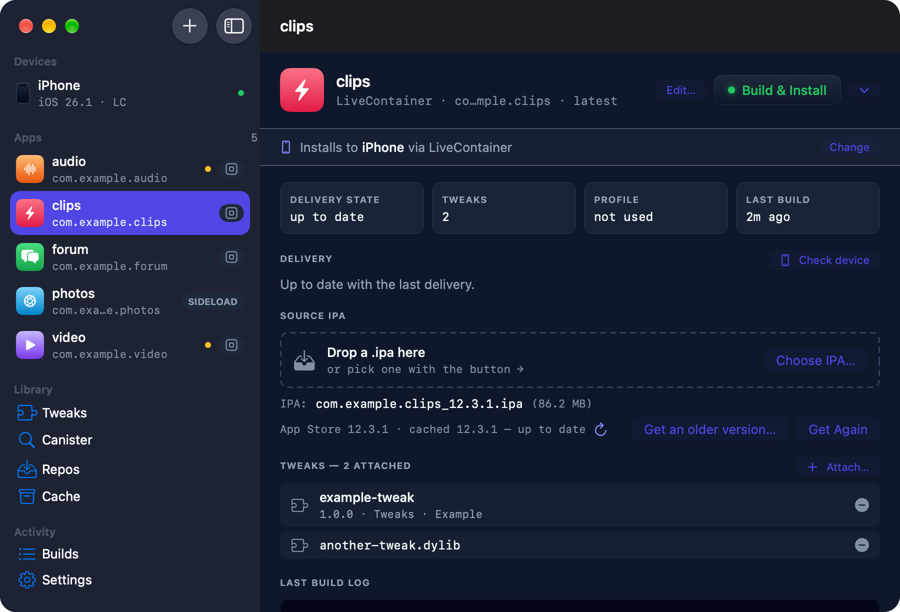

# Graft

Graft: inject tweaks and install IPAs, into LiveContainer with a free Apple ID
or signed with your paid Apple Developer account. An IPA signer for iPhone and
iPad, as a native Mac app, with a CLI for Terminal.

Graft takes a decrypted IPA, injects `.deb` or `.dylib` tweaks into it, and
delivers the result to your iPhone or iPad over USB or Wi-Fi.

- Delivers into [LiveContainer](https://github.com/LiveContainer/LiveContainer),
  so an app keeps its original bundle id, or signs and installs it as a
  normal app with your own certificate and provisioning profile.
- Searches the App Store and downloads apps your Apple ID owns or can get for
  free, then decrypts them on this Mac, including an older version when a new
  one breaks a tweak. It also takes an IPA you already have, or a dump from
  your own jailbroken device.
- Exports the tweaked IPA unsigned instead, for an on-device signer or
  TrollStore on your own devices.
- Finds tweaks on canister.me and in APT repositories, and checks them for
  updates.
- Checks your apps and their tweaks for updates once a day, and brings an app
  up to date with Update & Install: the newer App Store version, newer tweaks, one
  build, installed on each device it's on.
- Keeps a build history and archived builds for rollback, and tells you when
  a device is behind your config.
- Installs, updates and signs LiveContainer itself, including side-by-side
  instances.

Everything happens in the app. There's nothing to install in Terminal.



If Graft helps you, a [star on GitHub](https://github.com/GreenglassT/Graft)
helps others find it.

## Install

1. Download `Graft.zip` from [GitHub Releases](https://github.com/GreenglassT/Graft/releases).
   On an Intel Mac, download `Graft-Intel.zip` instead (a test build; see
   [Requirements](#requirements)).
2. Unzip it, move `Graft.app` to `/Applications`, and open it.

Graft.app carries everything it needs:
- the `graft` CLI, with its own Python;
- cyan, zsign, ldid, ipatool, UnfairPlay and the other helpers.

You don't need Homebrew, pipx, Python, Go, Xcode or libimobiledevice. The
one exception is decrypting on a jailbroken device, which still needs
libimobiledevice's `iproxy` and tools you install yourself (see
[Decrypt on a jailbroken device](#decrypt-on-a-jailbroken-device)).

Coming from Graft 1.x? See [Upgrading from Graft 1.x](docs/upgrading.md).

## Requirements

- **A Mac with macOS 14 or later,** or macOS 13 or later for the Intel
  download. On a Mac with Apple silicon, download `Graft.zip`, which does
  everything.
- **On an Intel Mac,** download `Graft-Intel.zip`, which also runs on
  macOS 13. It's a test build until it has run on a real Intel Mac.
  Everything works except what needs Apple silicon:
  - App Store sign-in, and getting and decrypting App Store apps, older
    versions and free ones included (search still works, for adding an app
    by name, and needs no sign-in);
  - Set Up Decryption;
  - Build for this Mac, and handing builds to PlayCover.

  Those buttons are there but disabled, with "Needs a Mac with Apple
  silicon". Use a decrypted IPA you already have, or dump one from a
  jailbroken device. `Graft.zip` opened on an Intel Mac only says to download
  `Graft-Intel.zip`; `Graft-Intel.zip` on an Apple silicon Mac runs, with a
  banner saying to download `Graft.zip` for everything.
- **An iPhone or iPad** paired with this Mac, connected by USB, or on the
  same network with Wi-Fi sync turned on.
- **An Apple account,** of one of two kinds. The first run asks which you
  have, and Settings switches later.
  - A **free Apple ID**, with LiveContainer on the device. Graft builds
    unsigned IPAs and pushes them into LiveContainer, which signs them when
    you import them. Graft never signs anything itself on this account.
  - A **paid Apple Developer Program membership**, with a development
    certificate exported as a `.p12` and a provisioning profile (a wildcard
    profile is simplest) that includes your device.

### What each feature needs

| To | You need |
|---|---|
| Build and push into LiveContainer | LiveContainer on the device. With a free Apple ID, install it with SideStore, AltStore, iloader or Impactor, which also refresh it every 7 days. |
| Install an app as a normal app (Sideload) | A paid membership, its `.p12` and a profile that includes the device. |
| Install or update LiveContainer from Graft | A paid membership and an App Store Connect API key. |
| Make each app's provisioning profile automatically | A paid membership and an App Store Connect API key. |
| Search the App Store | Nothing. No Apple ID is involved. |
| Download from the App Store | A Mac with Apple silicon, and an Apple ID signed in in Graft. Any Apple ID works, free or paid; it's separate from the account above. The app must be one that Apple ID owns, or a free one Graft can get for it. |
| Decrypt App Store downloads | A Mac with Apple silicon, and an iPhone or iPad app installed on it from the Mac App Store, with the same Apple ID, and opened once. Any free one will do. |
| Decrypt on a jailbroken device | A jailbroken iPhone or iPad with frida-server 16.x and OpenSSH, plus tools you install yourself (see [Decrypt on a jailbroken device](#decrypt-on-a-jailbroken-device)). |
| Run a build on this Mac | A Mac with Apple silicon, and [PlayCover](https://github.com/PlayCover/PlayCover/releases), a free app you install yourself. Graft doesn't include it. |

## Getting started

### 1. Set up your Apple account

The first time it opens, Graft asks "Do you have a paid Apple Developer
account?"

**No, I have a free Apple ID.** That's all on the Mac. Graft lists the steps
to do on the iPhone or iPad, with your free Apple ID:

1. Install [SideStore](https://sidestore.io), or use
   [iloader](https://github.com/nab138/iloader).
2. Install LiveContainer
   ([guide](https://livecontainer.github.io/docs/installation/lc_sidestore)).
   The LiveContainer+SideStore build uses one app slot for both.
3. In LiveContainer, open Settings and tap Import Certificate from SideStore, so
   it can sign the apps you import. iloader doesn't do this for you, and on
   iOS 26 every app fails its first launch with "JITLess mode is required since
   iOS 26" until it's done.

Graft finds LiveContainer on the device by its bundle id, so there is no team
id to set up.

**Yes.** Choose your `.p12`, type its password (leave it empty if you set
none), and choose your provisioning profile. Graft shows the team and the
devices the profile covers before it sets anything up. It keeps the password
in your login keychain, never in a file, and copies both files into its config
folder.

**Later.** The Account row in Settings switches between the two, with **Add
a paid account…** or **Switch to a free Apple ID…**, and keeps your apps,
repos and settings either way. With a paid account, **Replace certificate
and profile…** swaps in a new pair when the old one expires, which happens
every year.

### 2. Add an app

Press **+** at the top of the sidebar. Add App opens on **Search**: type an
app's name, pick it from the results, choose its delivery, and press **Add**.
You can also paste its App Store URL, or fill in a name and bundle id by hand.
See [Adding an app](#adding-an-app).

### 3. Give it a decrypted IPA

A build needs a decrypted IPA of the app. There are three ways to get one:

- **From the App Store.** Once you've signed in and set up decryption (see
  [App Store downloads](#app-store-downloads)), the app's Source IPA section
  has **Get latest from App Store**. Graft downloads the app, decrypts it on
  this Mac, and stages it.
- **An IPA you already have.** Drop it on the app's pane.
- **A dump from your own jailbroken device**, from the device's Decrypt card.
  See [Decrypt on a jailbroken device](#decrypt-on-a-jailbroken-device).

These are for **personal use**: your own Apple ID, apps you own or get for
free, on your own devices. Don't redistribute decrypted or modified IPAs.

### 4. Attach tweaks

Find tweaks under **Canister** or in your **Repos**, download them into
**Tweaks**, then press **Attach…** on the app's pane. A `.deb` or `.dylib`
you already have goes into the tweaks folder too. See [Tweaks](#tweaks).

### 5. Build and install

Press **Build & Install**.
- **LiveContainer delivery:** Graft pushes the IPA into LiveContainer's
  Documents. Open LiveContainer on the device and import it from there. That's
  when LiveContainer signs it and the tweaks start loading.
- **Sideload delivery (paid only):** Graft signs the IPA with your
  certificate and installs it as a normal app.

Builds lists every build, with its log and archive. See [Building](#building).

## App Store downloads

Graft downloads the App Store's IPA with ipatool and decrypts it with
UnfairPlay, both inside Graft.app. It only downloads apps your Apple ID
already owns, or free ones it gets for that Apple ID; a paid app is bought in
the App Store, never by Graft. Everything happens on your own Mac, for your
own devices.

Two one-time steps, both in Settings › App Store. Settings is the last item
in the sidebar, under Activity: Graft has no separate Settings window, so
⌘, opens nothing.

### Sign in

Press **Sign In…**, type your Apple ID (email or phone) and password, then
the 6-digit code if Apple asks for one (it doesn't always).

- Graft types them into the bundled ipatool's own prompts. They go only to
  Apple, through that ipatool. Graft never saves them, and never puts them on
  a command line, in the environment or in a log.
- ipatool, which comes with Graft, keeps your sign-in, including your
  password, in your login Keychain, as it does when you use it on its own.
- The first App Store action on a Mac (usually the first sign-in) downloads
  ipatool's App Store components (about 320 MB, skipped if a 1.x ipatool
  already downloaded them) and its Unicorn emulator, and can take several
  minutes. Later ones take under a minute. See [What Graft downloads, and when](#what-graft-downloads-and-when).
- If you signed in with your own ipatool under Graft 1, the sheet says so
  first: signing in here removes that sign-in, and your own ipatool will need
  to sign in again if you still use it in Terminal. See
  [Upgrading from Graft 1.x](docs/upgrading.md#your-app-store-sign-in).

While you're signed in, **Sign In Again…** sits beside **Sign Out**. Use it
when Apple has ended the session: a get then says so, and names the button.
**Sign Out** signs ipatool out.

### Set up decryption

1. Install any free iPhone or iPad app from the Mac App Store (only an Apple
   silicon Mac can), signed in there with **the same Apple ID** you use in
   Graft, and open it once.
2. Press **Set Up Decryption…**. In the sheet, pick that app (the first one
   is already picked) and press **Set Up Decryption…** again. Graft then
   explains what will happen. Open the app once first (the sheet's **Open**
   button does it): macOS sometimes clears the App Store state UnfairPlay
   reads, and opening the app writes it again. Then press **Continue**.
3. macOS's dialog usually names Graft and asks you to allow it administrator
   access ("Allow administrator access for “Graft”?"). On a Mac with Touch ID
   it offers Touch ID or **Use Password…**; on one without, it asks for your
   password. If Graft has to start this step through osascript instead, the
   dialog names osascript. **Cancel** stops here. Graft never sees the
   password.

If your macOS account isn't an administrator, macOS's dialog asks for an
administrator's name and password instead, so someone who administers this
Mac has to type them. The rest is the same: Graft never sees them, and the
decryption model it sets up is yours.

What happens:
- Before root copies anything, it checks that this Mac's App Store state
  (`SC Info.sidb`) is there. If it isn't, the step stops at once, nothing is
  changed, and Graft says which app to open.
- Graft explains the step before macOS's dialog appears, and shows the exact
  command under "The exact command, run as root".
- Root works only in a folder of its own, on its own copy of the app, and runs
  its own copy of UnfairPlay. In a Graft.app signed with a developer team, as
  releases are, root checks that copy against Graft.app's team before it runs
  it, and when Graft.app is signed with Developer ID, the copy must be too. A
  copy nothing can check is shown as a warning, and runs only if you
  press "Run Unchecked Copy as Root…".
- UnfairPlay saves a private decryption model, which Graft then moves into
  your own folder, as you.
- Cancel is always safe. The step also stops by itself if it runs far longer
  than expected (15 minutes for most apps, longer for a very large one).

Decryption then works only for apps downloaded with that Apple ID. If you
switch Apple ID, in Graft or in the Mac App Store, press **Set Up Again…**
with an app installed under the new one.

### Get an app

On the app's pane, **Get latest from App Store** downloads, decrypts and
stages the App Store's latest version. **Stop** cancels it and deletes the
download. If that version is already staged, nothing is downloaded and the
pane says "Already have <version>". The button then reads **Get Again**,
which asks first, then downloads, decrypts and stages it again.

- If your Apple ID doesn't have the app yet and it's free, the button becomes
  **Get (free)**. Graft asks first, then adds the app to your Apple ID's
  purchases at no cost, as Get in the App Store would, and downloads it.
- A paid app shows **Open in App Store** instead. Buy it there, then get it
  in Graft.
- Add App's Search offers "Get it from the App Store after adding" once the
  App Store is set up.

### Get an older version

When a new version breaks a tweak, you can go back to one that worked.
**Get an older version…**, beside Get latest on the app's pane, lists the
versions the App Store still has for your Apple ID, newest first, with each
one's date. Graft reads ten at a time, and **Show More** reads the next ten.
Press **Get** on one, and Graft downloads, decrypts and stages it as Get latest
does.

Graft then holds the app at that version: its builds use it, and the pane says
"Held at 1.2.0 · newest 1.4.0" instead of "update available". **Get latest
from App Store** lets go of the hold and gets the newest version again. The
hold is the app's preferred version, which Edit App also shows. A preferred
version set in Edit App is a hold too; Get latest sets it back to latest.

- Only apps your Apple ID has. If it doesn't have the app yet, get it first.
- Apple doesn't serve every old version. One it won't describe or hand over
  says so, and you can pick another.
- The App Store sometimes has more than one build with the same version
  number. Graft numbers them from the oldest, so "1.2.0 (build 1 of 2)" is
  the older and "1.2.0 (build 2 of 2)" the newer, and hovering over one says
  which it is. Show More renumbers them when it finds an older one.
- Getting one of those builds holds the app at that build: the pane says
  "Held at 1.2.0 (build 1 of 2)", and builds use that build even when the other
  is staged too. A version typed in Edit App holds by number only: changing
  the preferred version there lets go of the build, and saving Edit App with
  it unchanged keeps it. In Terminal, `graft --set-app-options --app <name>
  --preferred-version <version>` holds that version by number.
- Dropping an IPA of the held version on the app, or decrypting it from a
  jailbroken device, holds the app at that version by number, with a warning:
  Graft can't tell which build an IPA it didn't download is, so builds use the
  one you gave it.
- If the connection stalls, the list stops, and Try Again picks up where it
  stopped. A version that stalls twice in a row is marked as unavailable, and
  the list goes on.
- Some apps refuse to run once they're too old, and ask you to update.
- A version that's already staged is held without downloading it again,
  unless another build shares its number: a staged copy could be either, so
  Graft downloads the build you picked. Graft counts only the builds it has
  read: one with the same number further down, past Show More, isn't counted
  yet, and the staged copy is held by number. Show More first if you think
  there's another.
- An old version may be one UnfairPlay can't verify (see
  [Decrypts UnfairPlay can't verify](#decrypts-unfairplay-cant-verify)).

### Privacy

The downloaded IPA carries your Apple ID and your license for the app. Graft
keeps it in a private temporary directory, deletes it afterward, and runs
UnfairPlay with `--strip-account-data`. It doesn't rely on that flag.

Every IPA Graft stages, from any source, has `iTunesMetadata.plist` (your
Apple ID and account ids) and every `SC_Info/` license directory removed, and
is checked for them before it goes into the cache.
- An IPA staged by an earlier version is cleaned the first time a build uses
  it, and so is anything a re-install or a Mac install hands over.
- If the cache can't be written (a full or read-only disk), the build warns
  and goes on from a cleaned copy instead. Only when no clean copy can be made
  does it stop, rather than ship the data.
- A sideload archive keeps the license files its signature seals, since
  removing them would break the install. Rebuild it to get rid of them.

What gets staged, built and put on a device doesn't identify you.

### Decrypts UnfairPlay can't verify

UnfairPlay checks the decrypted pages against Apple's own hashes. If it can't
(some older apps), Graft refuses the IPA and offers **Use it anyway…**, which
says what that risks, then runs the same get or drop again. If such an app
crashes at launch, the decrypt is the likely cause.

## What Graft downloads, and when

Graft has no telemetry, analytics or crash reporting. Graft.app makes no
connections of its own: its CLI does, for something you asked for or a pane
you opened; to look up the icon of an app that has none yet; once a day to
ask GitHub whether a newer Graft is out, and to download it; and once a day to
check whether your apps and tweaks have updates. Settings › Updates turns
off the daily checks and the download. Device names and UDIDs never leave
your Mac.

| When | Who it contacts | What for |
|---|---|---|
| You search the App Store, add an app, open an app's pane, or plan or run an update; for an app with no icon yet, at launch, when the app list changes, and after a build or App Store get | Apple's iTunes lookup and search, and its artwork CDN | The app's version, price and icon |
| You search, fetch or update tweaks, or update an app | canister.me, and the repos you add | Tweak listings and downloads |
| A device's pane or its Set Up LiveContainer… sheet opens, Edit App opens for a LiveContainer app, or a LiveContainer install, certificate or clean-up on a device ends | GitHub | LiveContainer's releases |
| Once a day while Graft is open, unless Settings › Updates turns it off, and when you choose Help › Check for Updates… | GitHub (`api.github.com`), with nothing that identifies you or your Mac | Whether a newer Graft is out |
| At launch and once a day while Graft is open, and after a get, build, tweak update, update or change to an app's options or tweaks, or when a device connects or disconnects while an update waits for one (at most every 10 minutes), unless Settings › Updates › Check my apps for updates is off; and when you press Check for updates now | Apple's public iTunes lookup (one request per App Store country), and canister.me for attached tweaks with no recently cached repo index | Your apps' bundle IDs and your attached tweaks' package IDs, to see whether newer versions are out. No Apple ID. |
| A newer Graft is out, unless Settings › Updates turns automatic updates off (then when you choose Update) | GitHub's release files (`github.com`), with nothing that identifies you or your Mac | The new `Graft.zip` (`Graft-Intel.zip` for the Intel build), about 150 MB, once |
| A paid account with an App Store Connect key makes a profile, or a build signed with a profile Graft makes, or a LiveContainer install, targets a device missing from the saved list (Graft lists your registered devices; it never registers one) | Apple's App Store Connect API | Provisioning profiles |
| You sign in, get an app or an older version of one, list an app's older versions, or get a free one | Apple's App Store, through the bundled ipatool | Your sign-in, the license, the IPA, the versions' numbers and dates |
| The first App Store action on a Mac (usually the first sign-in) | PyPI (`files.pythonhosted.org`), and Apple's software CDN | ipatool's Unicorn emulator (a few MB) and its App Store components (about 320 MB, skipped if a 1.x ipatool already downloaded them), once |

About that first App Store action:
- Graft.app doesn't include Unicorn. The bundled ipatool downloads Unicorn
  2.1.4 from PyPI on first use, as upstream ipatool does, and checks it
  against the SHA-256 its source pins.
- Both downloads are cached in `~/Library/Caches/ipatool`, so they happen
  once, and again only for a new version.
- Offline, that first App Store action stops with "ipatool needs to download its App
  Store emulator (Unicorn, from PyPI) the first time; connect to the internet
  and try again."

UnfairPlay has no network code, and talking to your iPhone or iPad stays on
your Mac and your local network. [What Graft connects to](docs/network.md)
lists every host, when, and what is sent.

## Updating your apps

Graft checks your apps for updates at launch and once a day while it's open:
a newer version on the App Store, a newer build of a tweak an app uses, or a
build that changed since it was last installed. An app with something to
update shows an arrow mark in the sidebar, and its pane says what: "Update
available: App Store 1.2.0 · 1 tweak".
- **Update & Install** (or **Update Tweaks & Install**, or **Install
  Update**) shows what will change, app by app, and each device it installs
  on, then does it when you choose **Update**: the tweaks, the App Store
  download, one build, and an install on each device.
- **Update All**, above the apps when two or more apps have an update, does
  the same for each of them.
- An update installs on every device the app is on: each iPhone or iPad
  you've delivered it to, and only the ones that need it. It never adds a
  device, and the device picked for the next Build & Install doesn't apply.
- A device that isn't connected, even one unplugged during the update,
  waits: the app's pane says so ("iPad mini isn't connected: it'll update
  when it is"), and the app's other devices still update. When you connect
  it, Graft checks again within 10 minutes and offers its install. An update
  that only waits for a device doesn't mark the app in the sidebar or count
  in Update All.
- For a device you no longer use (sold, reset, or retired), **Stop
  updating** ("Stop updating Example on iPad mini"), in the menu beside its
  line on the pane or in the confirmation, stops updating that app there. It
  changes nothing on the device, and lasts until you install that app on that
  device again.
- Graft never buys or claims an app, and never moves an app off a version
  you're holding it at: that app still gets its tweak updates and install.
- After you re-install an older build on a device, or when the last install
  can't be found there, the pane says so and offers **Install Update** for
  that device (one for each, when there are several), for you to press. It's
  a Build & Install to that device; Graft doesn't install it on its own.
- When a tweak is shared, its other apps need an install too: the
  confirmation says which, and **Also install … now** adds them.
- **Stop** stops at once, except during an install or while a tweak is being
  swapped in, which finish first. **Stop Now** cancels that install, and
  after three minutes **Force Stop** ends it outright. The progress shows
  each device's install under its app, and how it went. **Try Again**, for
  every app or for one device, picks up where it stopped.
- LiveContainer apps end up in LiveContainer's Documents on each device, to
  import there.
- On an Intel Mac, a newer App Store version shows, and can't be downloaded.

Settings › Updates › **Check my apps for updates** turns the daily check off,
and the checks after a get, build, tweak update, update, change to an app's
options or tweaks, or device change.
With it off, Graft checks only when you press **Check for updates now**,
there, in the sidebar or on an app's pane, and the Update buttons show what
that check found. The check sends your apps' bundle IDs to Apple's App
Store lookup and your tweaks' package IDs to canister.me, and nothing that
identifies you or your Mac. It opens no connection to your iPhone or iPad and
reads nothing from the keychain.

## Updating Graft

Graft updates itself. Once a day while it's open (or when you choose Help ›
Check for Updates…), it asks GitHub whether a newer version is out. If one is,
it downloads it in the background, then shows **Restart to Update** in a banner
at the bottom of the main window. If you don't restart, it installs the update
when you quit Graft.
- Each download updates from its own zip: `Graft.zip` for Apple silicon,
  `Graft-Intel.zip` for the Intel build. A release without yours has no
  update for your Mac yet, and Graft never installs the other one.
- A release that needs a newer macOS than your Mac has is no update for your
  Mac either: Graft downloads it once, finds it needs a newer macOS, deletes
  it and stays on the version you have. It doesn't download that release
  again until your Mac has that macOS.
- Before it calls a download ready, Graft checks it: the SHA-256 GitHub lists
  for it, then that the app inside is Graft, newer than yours, the same build
  as yours, signed with the same developer's Developer ID as yours and
  notarized by Apple. A download
  that fails any check is deleted, and the banner links to the release page
  instead. A Graft you built yourself, which has no Developer ID, doesn't
  update itself.
- The old Graft.app goes to the Trash, so you can put it back.
- Graft never installs while it's working (a build, an install, an App Store
  download and so on). It waits until that's done, or until you quit.
- Settings › Updates has two switches for Graft: **Check for updates
  automatically** and **Download and install updates automatically**. With
  the second off, the banner offers **Update**, which downloads, checks and
  restarts when you choose it. Its third, **Check my apps for updates**, is
  for your apps (see [Updating your apps](#updating-your-apps)).
- Your config, apps and builds carry over, and so does your App Store
  sign-in from 2.0 on. From 1.x, you sign in once.
- The Terminal command points into the app, so it updates too.
- Help › What's New… shows what changed in each release. It also opens by
  itself once, the first time a new version of Graft starts.

Graft can't update itself when it runs straight from Downloads (macOS runs a
read-only copy of an app it hasn't moved), or from a folder your account
can't change. The banner then says so and links to
[GitHub Releases](https://github.com/GreenglassT/Graft/releases): download the
new `Graft.zip` (or `Graft-Intel.zip`) there and replace the `Graft.app` in
`/Applications`. If an
update can't be installed, Graft keeps the version you have, says so the next
time it opens, and writes what happened to `~/Library/Logs/Graft/update.log`.

From Graft 1.x, read [Upgrading from Graft 1.x](docs/upgrading.md) first:
what happens to your config, your pipx `graft`, your Homebrew tools and your
App Store sign-in, and how to go back to 1.1.

## Adding an app

Add App (**+** at the top of the sidebar) has three ways in.

**Search**, the default. Type an app's name, and the App Store's iPhone apps
that match appear as you type, each with its icon, developer and price.
- Results come from the store in the sheet's Store picker. It starts at this
  Mac's region (System Settings › General › Language & Region). A territory
  such as Puerto Rico or Réunion uses the store its people shop in (US,
  France), and a region with no App Store uses the US store and says so.
- Pick one with the mouse or the arrow keys, choose its delivery, and press
  **Add** (or Return). That adds it exactly as its App Store URL would.
- A paid app shows its price, and a listing that gives none says "Price
  unknown", never "Free". A result already in your config says so, and names
  the app it was added as.
- Apple's own apps can be found but not got: iOS ships them, and only Apple
  can sign them.
- Apple limits how often one Mac can search. A term you already searched
  while the sheet is open is answered from memory, and if Apple does say no,
  the sheet says to try again shortly.

**From App Store URL:** paste the app's `apps.apple.com` link.

**Manual:** a name and a bundle id, and optionally an IPA you already have.

**Which store an app is looked up in.** Graft remembers the store an app came
from (`store_country` in config.yaml), and checks its updates, its icon and
its price there. Edit App shows it under App Store and can change it.
- An app added from a URL keeps the store the URL names
  (`apps.apple.com/gb/...`, or the older `itunes.apple.com/gb/...`).
- An app with no store (one added in Graft 1.x, from a URL that names none, or
  by hand) is looked up in the store of this Mac's region, then in the US
  store, the one 1.x always asked. The first that sells it answers, and
  nothing is written. When neither has it, the error names both stores.
- A hand-written `store_country` that isn't an App Store is ignored, with a
  warning; `UK` is read as `GB`.

## Delivery

Each app has a delivery mode, LiveContainer or Sideload. An app added without
one is LiveContainer with a free Apple ID and Sideload with a paid account.
Graft writes the mode whenever it adds an app, so an app keeps its mode if the
config later changes account. Change it in the app's Edit sheet.

### LiveContainer (recommended)

LiveContainer delivery builds the tweaked IPA unsigned and pushes it into
LiveContainer's `Documents` folder over USB or Wi-Fi. You then import it
inside LiveContainer, which runs it as a guest app.

Why this is the main path: a guest app keeps its **original bundle id**, and
some apps tie sign-in to their original bundle id. It also needs no
provisioning profile of its own, so zsign, the profile and the
device-in-profile checks are skipped for these builds.

How a delivery works:

1. Build & Install pushes `Documents/<name>.ipa` into LiveContainer.
2. On the device, open LiveContainer. The IPA is in its Documents; import it
   as an app. LiveContainer signs it on import, and that is when the tweaks
   start loading.
3. Optionally remove the pushed IPAs afterward, with Clean up in the device's
   LiveContainer section.

Delivering is not installing: Graft can see what it put in Documents, not
whether you imported it. See [Delivery state](#delivery-state).

### Sideload (paid only)

Sideload delivery signs the IPA with zsign, using your `.p12` and profile, and
installs it on the device as a normal top-level app. The device's UDID must be
in the profile. Use this for apps that don't care about their bundle id or
signing team. On a free Apple ID, building, re-installing or adding a sideload
app is refused.

On iOS 16 and later, an app signed with a development profile opens only with
Developer Mode on. Graft checks before building one and stops if it's off. A
real build first makes the switch appear in Settings › Privacy & Security ›
Developer Mode, which iOS hides until a development app is installed: turn it
on there, and confirm after the device restarts. The device's page shows
whether it's on. Ad hoc and enterprise profiles, and LiveContainer delivery,
don't need it.

## LiveContainer

If LiveContainer is already on the device through SideStore, AltStore,
iloader or Impactor, Graft uses it as it is. With a paid account Graft can
also install and update LiveContainer itself, signed with your certificate so
that guest apps keep their logins.

A device's pane has a LiveContainer section. It lists what is installed and
who manages it, on either account.
- **Set Up LiveContainer…** does the whole setup in one sheet. With a paid
  account, its **Set Up** button checks the device against your developer
  account (reading the registered devices again if the device is new to
  them), installs LiveContainer from its own GitHub releases, and puts the
  certificate on the device. It stops at a step that fails and says what's
  left. After a failed certificate step, Set Up again puts the certificate on
  without installing again. **Install / Update LiveContainer** and **Put
  certificate on device** are in the sheet too, one step at a time. While a
  step runs, the sheet stays open until it ends or you press **Stop**.
- The sheet then lists the steps on the device, naming it: Import Certificate
  in LiveContainer's Settings, JIT-Less Diagnose, import your apps, and
  Convert to Shared App. LiveContainer asks for your .p12's password on the
  device; Graft can't type it for you. Selecting **I imported the
  certificate** takes the certificate off the device at once.
- With a free Apple ID, the sheet has no Set Up button: it links to SideStore
  and iloader, which install LiveContainer with your Apple ID, and lists the
  same steps on the device.
- Where SideStore or AltStore is on the device, Set Up is disabled, and the
  sheet's first step is Import Certificate from SideStore.
- While a certificate Graft put on the device is still there, the section
  says so, with **Remove it**.
- **Clean up** is there whenever the device has a LiveContainer, whoever
  installed it.

Up to three LiveContainers can be installed side by side, as
`com.kdt.livecontainer.<TEAM>` (the primary), `com.kdt.LiveContainer2.<TEAM>`
and `com.kdt.LiveContainer3.<TEAM>`. Every installer names them this way, with
its team id, so Graft finds them on the device by bundle id: a ten-character
team id after the name, whatever team it is, in any letter case. A free Apple
ID needs no team id in the config. System apps count too, so a LiveContainer
that TrollStore or a jailbreak installed (often as plain
`com.kdt.livecontainer`) is found, and so is one an on-device re-signer gave
some other suffix.

Which one a build pushes into, in this order:

1. the app's pin (the LiveContainer picker in its Edit sheet, or
   `lc_bundle_id:` in config.yaml), in any letter case, or the id without its
   team suffix when that names exactly one. A pin that names nothing
   installed, or an app that isn't LiveContainer, stops the build with what
   was found; it's never quietly ignored;
2. the only LiveContainer on the device, whatever its bundle id;
3. with a paid account, the configured team's primary;
4. the only primary (`com.kdt.livecontainer.<TEAM>`, or plain
   `com.kdt.livecontainer`).

Anything else stops the build with a list of what was found. That includes
plain `com.kdt.livecontainer` next to a `com.kdt.livecontainer.<TEAM>`: Graft
can't tell which one you import from, so it asks you to pin one rather than
guess. A build finds out before it injects anything: the push's target, and
whether its `<app>.ipa` name is free there, are checked ahead of cyan. The
sidebar names the LiveContainer a push would use, found the same way.

Notes:

- Installing LiveContainer needs an App Store Connect API key (Settings › App
  Store Connect) to fetch profiles. It also needs the App IDs above (plus the
  primary's extensions) registered at developer.apple.com with the App Groups
  capability and the group `group.com.SideStore.SideStore.<TEAM>` assigned.
  App groups can't be assigned through the API; if one is missing, the error
  names the App ID.
- On a device where AltStore or SideStore manages LiveContainer, Graft won't
  install over it, because replacing those copies would break every guest app
  signed through them. Update through AltStore or SideStore instead.
- **Put certificate on device** is for a LiveContainer Graft installed: it has
  no AltStore to take a certificate from, and its JIT-less mode needs one.
  Import it in LiveContainer's Settings, then select **I imported the
  certificate** in the sheet, or press **Remove it** on the device's pane.
  Until then the certificate sits where guest apps can read it.
- Graft never deletes or replaces a file in LiveContainer's Documents unless
  it knows the file is its own: a delivery record for that device and that
  LiveContainer, or, with no record (after a state reset, say), the file's
  SHA-256 matching one of that app's archived builds.
  - Clean up removes only the IPAs Graft's deliveries recorded and a
    certificate it recorded pushing, and retires those records, so a file you
    later put there under the same name is yours.
  - An `AppleDevelopment.p12` with no record (one pushed by Graft 1.0, or your
    own) is reported and left in place. Putting the certificate on the device
    replaces it only when its bytes are your configured `.p12`.
  - A build whose IPA name (`<app>.ipa`) is already taken by a file that isn't
    Graft's stops instead of overwriting it. Rename or remove that file in the
    Files app, then build again. A re-push of Graft's own earlier delivery
    replaces it as before.

## Other ways to get an IPA

A build needs a **decrypted** IPA of the app, staged in
`~/.cache/graft/ipas/`. Graft checks every Mach-O binary in it before
injecting and warns if any is still encrypted; the build carries on, but the
app will most likely not launch. With nothing staged, the build stops and
lists the ways to get one. The App Store route is above, under
[App Store downloads](#app-store-downloads).

### Bring your own

Drop the IPA on the app's pane, or choose it in Add App's Manual mode. Graft
checks that the IPA's bundle id matches the app's and stages it under its
canonical name. An IPA that is still encrypted (straight from the App Store)
is decrypted with UnfairPlay on the way in if decryption is set up, and
refused if it isn't.

### Decrypt on a jailbroken device

The device's Decrypt card dumps an installed app off your own jailbroken
iPhone or iPad, and **Add as app** turns the dump into an app. This path needs
tools Graft.app doesn't include, which you install yourself:

| Tool | Used for |
|---|---|
| [frida](https://frida.re) 16.x on the device | Both backends. The device's frida-server must be 16.x, the major frida-ios-dump's virtualenv installs. Graft has no frida of its own: it asks frida-ios-dump's (`graft_ipa/frida_probe.py`), so until frida-ios-dump is set up, the decrypt check can't reach frida-server and says so. |
| [frida-ios-dump](https://github.com/AloneMonkey/frida-ios-dump) | One backend. Clone it to `~/.local/share/graft/frida-ios-dump`, check out `56e99b2` (its last release for frida 16; the current one needs frida 17), and create a `.venv` there with `pip install 'frida==16.*' paramiko scp tqdm`, or set `GRAFT_FRIDA_IOS_DUMP`. The decrypt check prints these commands when it isn't set up. Needs OpenSSH on the device. |
| [bagbak](https://github.com/ChiChou/bagbak) | The other backend. `npm install -g bagbak@4.0.3` for a 16.x frida-server. |
| `iproxy`, from libimobiledevice | The SSH tunnel to the device. `brew install libimobiledevice`, or from MacPorts, `sudo port install libimobiledevice`. |

The card checks what, if anything, is blocking a dump right now. Unless you
choose a backend, Graft picks the one that can run, preferring frida-ios-dump:

- **frida-ios-dump** attaches to the running app. Graft brings it to the
  foreground first, launching it if needed. It copies the bundle over SSH:
  store the device's root password with **Set root password…**, or set
  `GRAFT_SSH_KEY` (and `GRAFT_SSH_USER` if it isn't `root`).
- **bagbak** spawns the app itself. bagbak 4.x (the version that works with a
  16.x frida-server) also copies the bundle over SSH, using the same stored
  root password; it can't use `GRAFT_SSH_KEY`.

A dump is always of the whole app, which is what gets verified and staged. A
dump that leaves app extensions encrypted (an extension built for a newer iOS
than the device runs) drops them and stages the rest, and says what it
removed. The app keeps working, minus those widgets and share extensions.

### Staged IPAs

**Cache** lists every staged IPA, and marks the one a build uses when a bundle
id has more than one. From there you can add a dump as an app, install it on
this Mac with PlayCover, or delete it. Staged IPAs are never pruned.

## Tweaks

- **Canister** searches canister.me. A download by package id is checked
  against Canister's published SHA-256, when Canister has one.
- **Repos** adds APT repositories and lists their packages. Free repositories
  only; repos that need a login or payment aren't supported.
- **Tweaks** lists your library (`~/.config/graft/tweaks/`), checks it for
  newer published versions when you ask, and updates a tweak, re-pointing the
  apps that use it. Deleting one an app still uses asks first, and offers
  Detach and Delete. Deleted tweaks go to the Trash.

### Shared libraries

cyan bundles ElleKit as CydiaSubstrate and adds a few common frameworks when a
tweak links them, but not every shared library a tweak may link against
(color or settings libraries, for example). If a build fails with
`Library not loaded: @rpath/libexample.dylib`, put a sandbox-compatible copy of
that library in the tweaks folder and attach it to the app, as you would a
`.deb`.

### Rootless tweaks only

Tweaks built for RootHide depend on `libroothide.dylib`, which doesn't exist
outside a jailbreak. Use the rootless build from the developer's own
repository or releases.

## Building

Build & Install runs this pipeline. Build options (beside it) picks the
device and can build without installing. It can also export the IPA unsigned
instead (see [Exporting an IPA](#exporting-an-ipa)).

1. **Pre-flight.** Tools, signing files, password, device, and that the device
   is in the profile. Only what the delivery mode needs is checked. Settings ›
   Preflight, and `graft --check` in Terminal, check the same without
   building. There, no device connected is information ("not connected"), not
   a failure; a build that installs still needs one.
2. **Source IPA.** The decrypted IPA staged in `~/.cache/graft/ipas/`.
3. **Decryption check.** The load commands of every Mach-O. Any that is still
   encrypted is reported as a warning naming the binary, and the build carries
   on.
4. **Inject.** cyan, with the app's tweaks and options. The original bundle id
   is kept by default. cyan's output is meant to be re-signed: its modified
   binaries carry stale signatures until then. Every delivery re-signs before
   anything runs: zsign for Sideload, LiveContainer on import, SideStore or
   PlayCover on install. A LiveContainer build that isn't installed is for one
   of those signers.
5. **Sign** (Sideload only). zsign with your `.p12` and profile.
6. **Archive.** Copy the result to `~/.cache/graft/built/`.
7. **Deliver.** Push into LiveContainer, or install on the device.
8. **Record.** Write the build to `~/.local/state/graft/log.sqlite` and apply
   archive retention.

**Stop** ends the build where it is. A stopped build shows as Stopped, not as
a failure, and adds no row to Builds.

### Which device a build goes to

With nothing picked, a build goes to the default device when it's connected,
else to the only other device connected. With several connected and none of
them the default, the app pane's bar asks you to pick one, and Build & Install
waits until you do. **Change** on the bar lists the connected devices, with
their iOS version and, for a LiveContainer app, whether LiveContainer is on
them. Picking one sends the next Build & Install there only ("Next Build &
Install: iPad Air via LiveContainer · then back to iPhone 15 Pro"); the ✕
clears it, and it clears itself once that build starts installing or succeeds.
A build that fails or is stopped before installing keeps it for the retry. A
picked device that's unplugged stops Build & Install too, until you plug it in
or clear the pick. Build options' Device picker sets the same pick. Updates
don't use it: an update installs on every device the app is on. The
menu also makes a device the default. In Terminal, `--device <UDID>` does the
same for one build, and that device must be connected. When a build goes
somewhere other than the default, its log says where and why.

For a LiveContainer app, a device without LiveContainer can't take the build:
the bar says so and offers **Set Up LiveContainer…** for that device, over the
app pane. When a Sideload build signed with a profile Graft makes, or
installing LiveContainer, goes to a device added to your developer account
since you last saved App Store Connect in Settings, Graft reads the account's
devices again first and saves the new list. A profile you made yourself isn't
changed. Graft never registers a device.

## Build history and retention

**Builds** lists every build, with its saved log (View log…). A build's
archive can be delivered again without rebuilding (Re-install…), or shown in
Finder (Reveal in Finder).

Re-install… asks first. It names the app, the build (its version and when it
was made) and the iPhone or iPad it installs on: the one the build went to,
else your default device, else the first one connected. When that device isn't
connected, it says so and installs nothing. Return re-installs, and Escape
cancels.

A re-install goes out the way the archive was built: an unsigned LiveContainer
archive is never installed as a top-level app, and a zsign-signed one is never
pushed into LiveContainer. If the app's delivery mode has changed since,
rebuild it. For a build recorded before Graft 1.1 noted the mode, the archive
itself says (zsign's embedded profile).

After each successful build, all but the newest `archive_keep` archives **per
app version** go to the Trash (default 2; `0` keeps only the build just made).
- Grouping by version means rebuilds of one version never push out the last
  build of an older version, so you can always roll back to a version you
  shipped.
- Builds you can re-install are kept first. An archive left by a build whose
  install failed only keeps a slot none of those needs.
- Archives go to the Trash, not straight to deletion, so the space comes back
  when you empty it. Staged source IPAs are never pruned.

**Clean up old builds…** in Builds does the same at your `archive_keep`: it
says how many archives would go to the Trash, and moves them when you confirm.
Useful after lowering the setting. The button is disabled while a build runs.

A clean-up never moves an archive that is still in use.
- A build holds a lock from the moment it archives its IPA until its history
  entry is written, and a re-install holds it until the archive is delivered.
- A Mac install copies a built archive under the lock and hands PlayCover the
  copy, since PlayCover reads the file after Graft has returned.
- A clean-up you start waits up to 30 seconds for them to finish, then stops
  with an error and moves nothing. A build's own clean-up doesn't wait: if
  another build is delivering, it skips this time and says so, and the next
  build catches up. Two clean-ups at once take turns.

## Delivery state

The app list and each app's pane say whether building now would produce
something different from what was last delivered. On every delivery Graft
records a SHA-256 over what determines the build: the source IPA's bundle id
and version, each tweak's filename and contents, the cyan options and the
delivery mode. Comparing that with what the config would produce now gives one
of:

| State | Means |
|---|---|
| `never` | Nothing has been delivered for this app. |
| `stale` | Something changed since the last delivery; the reasons say what (for example `some-tweak.deb rebuilt since delivery` or `app version changed: 1.2.3 → 1.3.0`). |
| `current` | Matches the last delivery. |
| `unknown` | Graft can't tell (for example a tweak file it can't read, or no staged IPA), and says so instead of guessing. |

Tweak contents are hashed, not just names, because a tweak rebuilt from source
keeps its filename. The source IPA is identified, not hashed.

Limits worth knowing:

- **Delivered is not installed.** For LiveContainer, Graft knows it wrote the
  file, not whether you imported it. Checking the device lists LiveContainer's
  Documents and can only downgrade a state: a missing file means the record is
  out of date, but a present file doesn't prove an import.
- Checking the device leaves sideload apps alone.
- A re-install of an archive that a recorded push shipped, byte for byte
  (usually the newest build), is compared like that push. Any other
  re-installed archive reads `stale`, because what went into it wasn't
  recorded.

None of this blocks a build.

## Running builds on this Mac

On an Apple silicon Mac, an app's pane has **Build for this Mac**, which makes
the build loadable under PlayCover and hands it to PlayCover. (On an Intel
Mac, PlayCover can't run, and the button is disabled.) A staged IPA or
an archived build can be handed over too. Some tweak libraries import iOS
private frameworks that macOS doesn't have; for these Mac builds Graft bundles
a minimal stand-in instead. Phone builds are never changed this way.

Graft.app carries that stand-in prebuilt, so a Mac build needs no Xcode. A
`graft` installed with pipx builds it on demand and needs full Xcode for that;
see [The CLI without the app](#the-cli-without-the-app-pipx).

Some tweaks need an iOS framework that macOS doesn't have at all. Graft won't
build such a tweak for this Mac, or hand over a build that has one, and says
which tweak and which framework. Phone builds can still use it. A framework the
app itself links only gets a warning.

After handing a build over, Graft waits up to two minutes for PlayCover to
finish installing it, and says when it has. If it hasn't by then, check
PlayCover's window; if the install failed there, Install to Mac… on the build's
row in Builds tries again. Stop ends the wait, not the install.

PlayCover has two settings per app that matter here: keymapping, which turns
clicks into touches for games, and PlayChain. On an app's first handoff Graft
turns both off and says so, because keymapping makes a non-game's clicks miss
and PlayChain crashed apps the first time they saved a login. After that Graft
keeps whatever you set in PlayCover: turn keymapping back on for a game, and it
stays on when you rebuild.

Not every iPhone or iPad app runs under PlayCover, even without tweaks: some
open to a blank window, can't open their data, or have buttons that don't
respond. If an app doesn't work, try it without tweaks first (Install to Mac…
on its IPA in the Cache pane); if that fails too, PlayCover can't run that app.

Graft doesn't include PlayCover, and doesn't download or install it. When
PlayCover isn't installed, Build options says so above Build for this Mac, and
**Get PlayCover** opens
[PlayCover's releases page](https://github.com/PlayCover/PlayCover/releases)
on GitHub in your browser. You can still build first: once PlayCover is
installed, Install to Mac… on the build's row in Builds hands it over. If a
handover fails because PlayCover isn't installed, the error names the same
page.

## Exporting an IPA

If you sign apps on the phone, with an on-device signer and a certificate
service, or install them with TrollStore, Graft can give you the IPA instead
of delivering it. **Export IPA…** in Build options builds the app as far as
injecting its tweaks, then saves that IPA where you choose.

- **What the file is.** The app's decrypted IPA with its tweaks injected and
  the app's options applied, with your Apple ID's purchase data removed. It
  isn't signed: the binaries cyan changed need re-signing before iOS runs
  them.
- **What to do with it.** Put it on the phone (in Files, say) and open it in
  your on-device signer, which signs it with your certificate and installs
  it. Or install it with TrollStore.
- **What Graft doesn't do.** It signs nothing and sends nothing to a device,
  whatever the app's delivery mode, so a free Apple ID can export a Sideload
  app too. Graft only saves the file; moving it to the phone is up to you.
- **It isn't a build in Builds.** An export adds no row to the build history
  and keeps no log, and archive clean-up never touches the file.
- **For your own devices.** It's an app your Apple ID owns or got for free.

The Save panel asks before replacing a file that's already there. Graft
builds the file in a temporary folder of its own and moves it to where you
chose once it's done, so a stopped or failed export leaves nothing in your
folder. Graft won't save into its own folders for staged IPAs and archived
builds, which it cleans up itself.

## Configuration

Settings holds what most people change: the default device, how many archives
to keep, the signing files on a paid account, the App Store Connect key, the
App Store sign-in, and the paths Graft uses. Each app's Edit sheet holds its
options. Everything is stored in `~/.config/graft/config.yaml`
(`$XDG_CONFIG_HOME/graft` if set), which you can also edit by hand. A
configured app looks like this:

```yaml
signing:                                # paid only; leave it out for a free Apple ID
  cert: ~/.config/graft/AppleDevelopment.p12
  cert_password_env: GRAFT_P12_PASS     # when set, used instead of the Keychain's
  profile: ~/.config/graft/wildcard.mobileprovision
  team_id: ABCDE12345

cache_dir: ~/.cache/graft/ipas
tweaks_dir: ~/.config/graft/tweaks
archive_keep: 2                         # archived builds kept per app version
# default_device_udid: <UDID>

apps:
  example:
    bundle_id: com.example.app
    preferred_version: latest
    delivery: livecontainer             # or sideload
    store_country: "GB"                 # the App Store it's looked up in
    # lc_bundle_id: com.kdt.LiveContainer2.ABCDE12345   # pin a LiveContainer
    tweaks:
      - some-tweak.deb                  # files in tweaks_dir
    cyan:
      display_name: Example
      keep_bundle_id: true              # some apps tie sign-in to their original bundle id
      strip_extensions: false
      strip_supported_devices: true
      compression_level: 6
```

The app re-reads your config each time its window comes back to the front, so
a change made in an editor or in Terminal shows without a relaunch. If
`config.yaml` doesn't parse, Settings says so at the top, shows the default
paths and saves nothing until it's fixed. Fix it in an editor, and the notice
clears when you come back to the window.

**Free or paid.** A config with no `signing:` section (or an empty one) is a
free Apple ID. `signing:` keys that end up at the top level (lost
indentation) are an error naming them, not a free config.
- **Add a paid account…** asks only for the `.p12` and the profile, then adds
  a `signing:` section to the config and keeps its apps, repos and settings.
  With a paid account an app with no delivery mode is a sideload app, so Graft
  writes LiveContainer delivery into each such app and says which. Nothing
  moves until you change one.
- **Switch to a free Apple ID…** removes the `signing:` section and keeps
  everything else. Apps with no delivery mode then go into LiveContainer. One
  set to Sideload stays set, and won't build until you switch it to
  LiveContainer.
- **Replace certificate and profile…** swaps in a new pair, its Keychain
  password and the `signing:` section, keeps everything else, and puts the old
  ones back if any step fails. When the new pair belongs to another team, the
  old team's Keychain password is removed.
- The paid setup checks that the `.p12` opens with its password and that the
  profile lists its certificate and hasn't expired. It copies both files into
  the config folder (0600, never through a link).

**Bundle id.** Some apps tie sign-in to their original bundle id;
`keep_bundle_id: true` (the default) preserves it. With `keep_bundle_id: false`
cyan renames it (to `new_bundle_id`, or the original plus `.plus`) in both
delivery modes, LiveContainer included. Renaming the bundle id also removes any
Apple Watch app, which can't install under a new id.

**Per-app profiles (paid only).** "Create the provisioning profile
automatically" in an app's Edit sheet (`auto_profile: true`) has Graft create
and cache a profile for the app through the App Store Connect API;
`profile: <path>` points one app at a specific profile. Both apply to sideload
builds only, and the option is locked on a LiveContainer app, which uses no
profile.
- Make an API key at
  [App Store Connect](https://appstoreconnect.apple.com/access/integrations/api),
  then give it to Graft in Settings › App Store Connect. Graft checks the key
  by listing your devices, and only then copies the `.p8` beside
  `config.yaml`.
- Setting a key replaces only the key and its devices. A `profile_cache_dir`
  you set by hand stays, and `device_udids` is refreshed every time with every
  enabled iPhone, iPad and iPod touch App Store Connect lists. To keep a list
  you curated, add `device_udids_pinned: true` to the `app_store_connect:`
  section.

**The lock file.** Graft takes a lock on `config.yaml.lock` beside the config
while it edits it, so the app and the CLI never write over each other. If you
keep the config in a dotfiles repository and symlink it, add
`config.yaml.lock` to that repository's `.gitignore`.

### Files

```
~/.config/graft/
├── config.yaml
├── config.yaml.lock
├── AppleDevelopment.p12
├── wildcard.mobileprovision
├── AuthKey_<KEY_ID>.p8  # App Store Connect API key
├── profiles/            # profiles made through that API
└── tweaks/              # .deb and .dylib files

~/.cache/graft/
├── ipas/                # staged decrypted IPAs (never pruned)
├── built/               # archived builds (newest archive_keep per app version)
├── artwork/             # cached app icons
└── updates/             # a newer Graft, downloaded and checked, until it's installed

~/.local/state/graft/
├── log.sqlite           # build history and delivery records
├── build-logs/          # saved event log of each --json build (so every build from the app)
├── repos/               # cached APT repository indexes
└── tweak-rollback/      # previous versions kept when a tweak is updated

~/.local/share/graft/    # tools you install for Graft (frida-ios-dump; UnfairPlay, for a pipx install)
```

These four `graft` directories are owner-only (0700): Graft creates them that
way and tightens them on every run if they aren't. Staged IPAs, archived
builds, build logs and the `.p12` and profile the setup copies are written
0600. Graft changes nothing outside these directories, and leaves alone a
`graft` that is a symlink you made. The one exception is updating itself: it
replaces its own Graft.app, moves the old one to the Trash, and writes what it
did to `~/Library/Logs/Graft/update.log`.

Outside them, the App Store tools keep their own files: ipatool's sign-in in
your login keychain, its session cookies in `~/.ipatool` and its downloads in
`~/Library/Caches/ipatool`, and UnfairPlay's model in
`~/Library/Application Support/unfairplay/models`. [Removing
Graft](#removing-graft) lists everything.

## Troubleshooting

| Symptom | Likely cause |
|---|---|
| `ApplicationVerificationFailed` | The `.p12` and profile are from different teams, or the device's UDID isn't in the profile. |
| `MismatchedApplicationIdentifierEntitlement` | The profile doesn't allow this bundle id; use a wildcard profile. Installing LiveContainer: delete an old zsign-signed copy on the device first. |
| `DeviceLocked` | Unlock the device. |
| `Developer Mode is off on <device>` | The device runs iOS 16 or later with Developer Mode off, and the app is signed with a development profile, so it wouldn't open. Turn it on in Settings › Privacy & Security › Developer Mode (a real build has made the switch appear), then confirm after the device restarts. |
| An app, such as an emulator, says it needs JIT | Graft doesn't turn on JIT. [StikDebug](https://github.com/StikDebug/StikDebug), an app on the iPhone, does. On iOS 26 and recent iPhones, only apps built to support it can get JIT, whatever tool you use. |
| `wrong password` from zsign | The `.p12` password is wrong. |
| `Library not loaded: @rpath/libexample.dylib` | Add a copy of that library to the app's tweaks; see [Shared libraries](#shared-libraries). |
| `couldn't extract some-tweak.deb` | The download is probably an HTML error page; fetch it again. |
| A guest app in LiveContainer doesn't remember its login | LiveContainer was signed with a wildcard profile's entitlements (for example by zsign). Reinstall it from Graft with a paid account. |
| A dump from a jailbroken device times out | Check the device's Decrypt card. Usually the frida majors differ, SSH to the device is down, or the app couldn't be brought to the foreground. |
| `no LiveContainer found on the device` | LiveContainer isn't installed, or not under a bundle id starting `com.kdt.livecontainer`. With a free Apple ID, install it through SideStore or iloader; see [Set up your Apple account](#1-set-up-your-apple-account). With a paid account, Graft can install it too. |
| `the device listed no apps at all, which is how a locked phone answers` | The phone is locked, or hasn't been unlocked since it restarted. Unlock it, stay on the home screen, and try again. |
| `... already has a Documents/<app>.ipa that Graft did not push` | LiveContainer's Documents already holds a file with the name the push uses, and neither a record nor its bytes say Graft put it there (it may be your own copy). Rename or remove it in the Files app (On My iPhone > LiveContainer), then build again. |
| `lc_bundle_id ... is not installed` | The app is pinned to a LiveContainer that isn't on the device. Pick one in the LiveContainer picker in the app's Edit sheet, or Automatic to drop the pin. |
| Settings › Preflight, or `graft --check`, says the device is "not connected" | No iPhone or iPad is connected. That's information, not a failure: a check installs nothing, so it needs no device. A build that installs still needs one: plug it in with a USB cable and trust this Mac. |
| `couldn't reach usbmuxd` | macOS's service for talking to iPhones didn't answer. Reconnect the phone; if it persists, restart the Mac. |
| `several devices are connected: pick one` | More than one iPhone or iPad is connected and none is the default device. Pick one with Change on the app's bar (it's for the next Build & Install only), pass `--device <UDID>` in Terminal, or set a default in Settings. |
| `... isn't registered in your developer account` | The device isn't one of your Apple Developer account's devices, so no profile can include it. Add it at developer.apple.com (Certificates, Identifiers & Profiles › Devices), then build again. Graft never registers a device for you. |
| `N LiveContainers are installed and Graft will not guess which to use` | There is no single primary: two LiveContainers installed by two Apple IDs, say, or a jailbreak's plain `com.kdt.livecontainer` next to an installer's `com.kdt.livecontainer.<TEAMID>`. Pin the app to one of the ids the error lists, in the LiveContainer picker in its Edit sheet. |
| `... needs a paid Apple Developer Program membership` | The config has no `signing:` section, so it is set up for a free Apple ID, and the action needs a paid one. Use LiveContainer delivery, or, with a paid membership, Settings › Add a paid account…; it keeps your apps. |
| Settings › App Store says "signed in by another ipatool (Graft 1's?): sign in again", or, with your own ipatool set in `config.yaml`, "a sign-in this ipatool can't read (another ipatool's?): sign in again" | Your sign-in was made by an ipatool this one can't read: with Graft's own, such as yours under Graft 1; with your own, Graft.app's or another. Press Sign In…; see [Upgrading from Graft 1.x](docs/upgrading.md#your-app-store-sign-in). |
| A decrypt fails as the wrong model or the wrong Apple ID | Decryption was set up with another Apple ID. Use the same Apple ID in Graft as in the Mac App Store, then press Set Up Again… in Settings › App Store. |
| Set Up Decryption… or Set Up Again… says this Mac's App Store state isn't there, or stops with "canonical input has no SIDB state" | macOS sometimes clears the state UnfairPlay reads, even for an app you've already opened. Open the app you picked once (the sheet's Open button does it), then set up again. In Terminal, the setup script exits 69 for this. |
| The first sign-in, or the first App Store action, fails with "Apple no longer serves the macOS 27.0.1 (26A434) restore image that ipatool 2.8.0 takes them from" | A known issue since 2.0. The bundled ipatool takes the App Store's frameworks from one macOS restore image, at a fixed Apple address, and checks every file it takes against its source's pins, so no other image can stand in. If Apple removes that file, a Mac that hasn't downloaded them yet can't get them; Apple's server then answers "403 Forbidden" (or "404 Not Found"), which the error's details show. A Mac whose ipatool already did (in `~/Library/Caches/ipatool`, a 1.x ipatool's included) isn't affected. Graft's update notice, or Help › Check for Updates…, says whether a later Graft is out (or look on [GitHub Releases](https://github.com/GreenglassT/Graft/releases)); a later Graft's ipatool will use an image Apple still serves. |
| Settings › App Store says "couldn't tell… your login keychain is locked" | Unlock the login keychain in Keychain Access, then refresh. Until then Settings offers neither Sign In… nor Sign Out, Get latest from App Store and Get (free) refuse, and so do `graft --appstore-login` and `--appstore-logout` in Terminal. |
| "Graft.app is damaged: part of it is missing." | A file inside the app is missing. Download Graft again and replace this copy. |

## Removing Graft

Dragging Graft.app to the Trash removes the app and everything inside it. What
it made outside the app stays until you remove it.

**In the app:** Help › Remove Graft's Data… lists all of it, with sizes. Check
what to remove, then press Remove…. It waits while Graft is building,
installing, downloading or setting something up. When it's done, it says what
it removed: quit Graft, then move Graft.app to the Trash. Removing can't be
undone.

**In Terminal:**

```bash
graft --remove-data                          # list it all, with sizes; removes nothing
graft --remove-data --items all --dry-run    # what --items all would remove
graft --remove-data --items all              # every item marked "removed with all"
graft --remove-data --items all,passwords    # and your passwords
graft --remove-data --items cache,temp       # only these
```

This is the whole list, by the name `--items` takes:

| Item | What | Where |
|---|---|---|
| `config` | Your setup: `config.yaml`, the `.p12` and profile Graft copied in when you set it up, your App Store Connect key and the profiles made with it, and your tweaks. The files you picked during setup stay where they were. | `~/.config/graft` |
| `cache` | Staged IPAs, archived builds and app icons, often several GB | `~/.cache/graft` |
| `state` | Build history and logs, repository indexes, earlier versions of tweaks you updated, Graft's record of its App Store sign-in, the names of the iPhones and iPads Graft has seen, the PlayCover settings it keeps for your apps, which devices you stopped updating an app on, and which App Store versions your Apple ID was refused | `~/.local/state/graft` |
| `data` | frida-ios-dump, and tools a pipx install of Graft uses | `~/.local/share/graft` |
| `legacy` | `tweak-build` folders from before the rename that Graft left beside its own, because both held files. Only when you name it. | `~/.config/tweak-build` and the like |
| `appstore-signin` | Your App Store sign-in: three items in your login keychain (service `ipatool-auth.service`, accounts `account`, `anisette-v4` and `kbsync-v1`) and ipatool's session cookies. Off when another ipatool made the sign-in. | the keychain, and `~/.ipatool` (or `$XDG_STATE_HOME/ipatool`) |
| `ipatool-cache` | ipatool's App Store components and its Unicorn emulator, about 320 MB | `~/Library/Caches/ipatool`, and `ipatool-*` folders in your temp folder |
| `unfairplay-model` | The decryption model Set Up Decryption made | `~/Library/Application Support/unfairplay` |
| `passwords` | Your `.p12` and SSH passwords. Only when you name it. | your login keychain, service `graft` (or `tweak-build` from before the rename), accounts `p12-<team id>` and `ssh-<device UDID>` |
| `graft-link` | `graft` for Terminal, when it's a link into Graft.app | `~/.local/bin/graft` |
| `app-settings` | The app's own settings. The app removes these; in Terminal, `defaults delete com.greenglasst.graft`. | `~/Library/Preferences/com.greenglasst.graft.plist` |
| `update-log` | The update log: what Graft wrote each time it updated itself, and the last rebuild's output for an app built from source | `~/Library/Logs/Graft` |
| `temp` | Temporary folders a stopped build, signing or install left behind, more than an hour old, and the rebuild marker of an app built from source | your temp folder (`$TMPDIR`), `~/Library/Caches/Graft` |

Keychain items are found and removed by their service and account only, and
nothing is asked of the keychain while it's locked. If you use ipatool or
UnfairPlay on their own, they use the same sign-in, components and model, and
removing them affects those too.

Never removed, and listed under "Not removed": anything `config.yaml` points
to outside these folders (`cache_dir`, `built_dir`, `tweaks_dir`, `state_dir`,
the signing files, the App Store Connect key and its profiles), a model folder
set by `appstore.unfairplay_models` or `UNFAIRPLAY_MODEL_DIR`, a `graft` folder
that is a link you made, and a `~/.local/bin/graft` that isn't Graft.app's (a
pipx one is removed with `pipx uninstall graft-ipa`).

If you set `XDG_CONFIG_HOME`, `XDG_CACHE_HOME`, `XDG_STATE_HOME` or
`XDG_DATA_HOME`, the four `graft` folders are under those instead. Builds and
tweaks Graft moved to the Trash stay there until you empty it. The Mac App
Store app you set up decryption with, PlayCover and the apps you installed on
this Mac with it, and LiveContainer and the apps on your devices, are yours to
keep or delete.

To do it by hand instead, delete what the table lists. For the keychain items,
search Keychain Access for `ipatool-auth.service` or `graft`.

## Graft in Terminal

Optional. Everything above works without it.

### Install graft for Terminal

In Graft.app, open Settings › Command-line tool and press **Install graft for
Terminal**. It links the app's own `graft` into `~/.local/bin`.
- If `~/.local/bin` isn't on your shell's PATH, the section shows the line to
  add to your shell's startup file, with a Copy button. Open a new Terminal
  window afterward.
- The command runs the CLI inside the app, so it updates with the app, and
  Terminal and the app can't drift apart.
- If another `graft` is already in `~/.local/bin` (a pipx install, say), the
  section says where it points and offers **Replace it…**. If a `graft` earlier
  on your PATH would win, it says that one is what Terminal runs.
- Move Graft.app to Applications first: the button won't link a copy running
  from a disk image or from where macOS put a downloaded app it moved aside.

### The CLI without the app (pipx)

To use Graft without the app, or to run it from source, install the CLI with
pipx:

```bash
pipx install git+https://github.com/GreenglassT/Graft     # brew install pipx, if you need it
pipx ensurepath
```

`pipx ensurepath` adds `~/.local/bin` to your PATH, so open a new terminal
afterward for the `graft` command to be found.
- It needs Python 3.11 or later (the test suite passes on 3.11, 3.12, 3.13
  and 3.14).
- Graft.app never uses a pipx install. It always runs the copy inside it.
- To update it, run `pipx reinstall graft-ipa`. Once a new version is tagged on
  GitHub, `pipx upgrade graft-ipa` works too.

A pipx install doesn't include the tools Graft.app carries. Install the ones
you use yourself:

| Tool | Used for | Install |
|---|---|---|
| `cyan` ([pyzule-rw](https://github.com/asdfzxcvbn/pyzule-rw)) | injecting tweaks | `pipx install --force https://github.com/asdfzxcvbn/pyzule-rw/archive/04a40f2aa65ec9cb36127f74d52ae4ef71377c50.zip` (the commit tagged v1.4.4, the release Graft is tested with) |
| `zsign` | signing, for Sideload delivery (paid only) | `brew install zsign` |
| [ipatool](https://github.com/majd/ipatool) 2.8.0 | App Store downloads | `graft --appstore-status` prints the commands that download the release for your Mac's processor and put it at `~/.local/bin/ipatool`. Use 2.8.0: 2.8.1 has a download bug, and Graft refuses it. |
| [UnfairPlay](https://github.com/DrWhax/unfairplay) v0.4.0 | decrypting App Store downloads, on Apple silicon | A Go program, built from source to `~/.local/share/graft/unfairplay/unfairplay`. `graft --appstore-status` prints the clone, checkout and `go build` commands. |
| Full Xcode, selected (`sudo xcode-select -s /Applications/Xcode.app/Contents/Developer`) | a PlayCover build whose tweak links an iOS private framework | The stand-in framework is compiled with Xcode's iOS SDK, which the Command Line Tools don't have. Only such a build needs it, and only at that step; `--check` doesn't look for it. |

`graft --check` lists each missing tool with the command that installs it, and
only the tools your apps' delivery modes use: zsign only when some app
sideloads (or, on a paid config with no apps yet, since a new app sideloads by
default). The `brew` commands need [Homebrew](https://brew.sh), and `--check`
says so when it isn't installed. Neither kind of install needs
libimobiledevice or the Xcode Command Line Tools for phone builds: Graft reads
binaries and installs apps itself, through pymobiledevice3.

Where each tool comes from:

- **cyan and zsign:** Graft.app's own copy, then your PATH. config.yaml has no
  setting for either.
- **ipatool and UnfairPlay:** a path you set in config.yaml, then Graft.app's
  copy, then their usual install location, then your PATH (so a Homebrew
  ipatool is found too).
  - Set them in an `appstore:` section (`ipatool:`, `unfairplay:`,
    `unfairplay_models:`), as full paths starting with `/` or `~/`. A relative
    one is ignored, with a warning each time Graft runs, and read as not set.
  - A path you set that points at nothing (you removed that ipatool, say):
    Graft.app, and the `graft` it links for Terminal, run their own copy
    instead, and `--appstore-status` notes the setting it passed over. Remove
    the key to stop the note. A pipx `graft` reports the tool as missing at
    that path.
  - An `appstore.ipatool` of `~/.local/bin/ipatool`, or an
    `appstore.unfairplay` of `~/.local/share/graft/unfairplay/unfairplay`, is
    the 1.x default written out. It counts as not set, so Graft.app's copy
    still comes first. `--appstore-status` says so for ipatool, and marks the
    UnfairPlay that runs "(bundled)". To make your own ipatool win, put it
    somewhere else and set the path.
  - Without `unfairplay_models:`, Graft uses UnfairPlay's own default:
    `UNFAIRPLAY_MODEL_DIR` if set, else
    `~/Library/Application Support/unfairplay/models`.
  - Setting up decryption in Graft.app always uses Graft.app's own UnfairPlay,
    because that step runs it as root.

`--check` and `--appstore-status` say which copy they found, and mark
Graft.app's own "(bundled)".

### Quick start in Terminal

With a free Apple ID (do the device steps under
[Set up your Apple account](#1-set-up-your-apple-account) first):

```bash
graft --init                        # answer no to the paid-membership question
graft --check                       # tools, the device, and LiveContainer on it
graft --appstore-search "example"   # find it: name, developer, price, bundle id
graft --add-app https://apps.apple.com/app/id123456789   # delivery: livecontainer
graft --provide-ipa ~/Downloads/Example.ipa --app example
graft --attach-tweak some-tweak.deb --app example
graft example                       # build and push into LiveContainer
```

With a paid Apple Developer account:

```bash
graft --init                        # answer yes: asks for the .p12 and profile, copies
                                    # them into ~/.config/graft/ and writes config.yaml
graft --set-p12-password            # store the .p12 password in the Keychain
graft --check
graft --add-app https://apps.apple.com/app/id123456789 --delivery livecontainer
graft --list                        # shows the name it was added under, e.g. "example"
graft --provide-ipa ~/Downloads/Example.ipa --app example
graft --search "some tweak"
graft --fetch com.example.sometweak         # downloads into ~/.config/graft/tweaks/
graft --attach-tweak some-tweak.deb --app example
graft example
```

If `--init` couldn't read the team id from the profile, it writes `team_id:
REPLACEME`. Set the real one with `graft --set-settings --signing-team-id
<TEAM>` before `--set-p12-password`: the Keychain entry is keyed by team id,
so `--set-p12-password` refuses until it's set. Instead of the Keychain, you
can export the variable named by `signing.cert_password_env`. When that
variable is set and not empty, builds use it rather than the Keychain's
password, so unset it once you store a new password in the Keychain.

`graft --init --account free` and `graft --init --account paid --p12 <file>
--profile <file>` do what answering the questions does, and are what the app
runs.
- The paid one reads the `.p12` password from stdin (one line), or asks for it
  without echo in Terminal, and makes the same checks as the app.
- Neither touches a config that doesn't parse.
- On a paid config, `--account paid` refuses unless given `--replace` (the
  app's Replace certificate and profile…), and `--account free` switches it
  to a free Apple ID (the app's Switch to a free Apple ID…): it removes the
  `signing:` section and keeps the apps, repos and settings. On a free config,
  `--account paid` adds the paid account (Add a paid account…).
- `--dry-run` checks everything and writes nothing.
- The interactive `--init` copies the files it's given as they are, so an
  expired profile shows up in `--check`, and a certificate the profile doesn't
  list only when the phone refuses the install.
- `--config <path>` works with any of these, for a config somewhere else. The
  app always uses the default one.

### CLI reference

Almost every command takes `--json` (see [Scripting](#scripting)), and every
one takes `--config <path>`. `graft --help` lists every flag but
`--describe` (see [Scripting](#scripting)).

**Apps**

```bash
graft --list                                       # apps: bundle id, pin, tweaks, delivery state, store (--json: account, mode)
graft --appstore-search "example"                  # iPhone apps that match, from this Mac's region's store
graft --appstore-search "example" --country GB --limit 10
graft --add-app https://apps.apple.com/app/id123456789 [--delivery livecontainer]
graft --add-app-manual --name example --bundle-id com.example.app --display-name Example --store-country GB
graft --remove-app example                         # cached IPAs and build history are kept
```

- `--appstore-search` needs no Apple ID. It asks the public iTunes Search API
  and sends only the search term and a country code. Its table ends with the
  `--add-app-manual` line for the store it searched: pass `--store-country` as
  it shows, so the app's update checks ask the same store.
- `--country` takes the two-letter code of a country with an App Store. A
  territory or `UK` is accepted as the store it uses (GB), with a note; a code
  with no store is refused. Without it, Graft uses the store of this Mac's
  region, or the US store if it can't read one or the region has none.
- `--limit` defaults to 25 and stops at 50. `--json` adds each result's icon,
  cached for a week in `~/.cache/graft/appstore-search-icons/`.

**App options**

```bash
graft --set-app-options --app example --delivery livecontainer   # or sideload
graft --set-app-options --app example --store-country GB          # the store it's looked up in
graft --set-app-options --app example --lc-bundle-id com.kdt.LiveContainer2.ABCDE12345
graft --set-app-options --app example --no-lc-bundle-id           # drop the pin
graft --set-app-options --app example --auto-profile              # or --no-auto-profile
```

`--set-app-options` also takes `--preferred-version`, `--display-name`,
`--[no-]keep-bundle-id`, `--[no-]strip-extensions`,
`--[no-]strip-supported-devices` and `--compression-level`.
`--auto-profile` on a LiveContainer app still saves it, with a warning that it
has no effect until the app is delivered by sideload.

**App Store**

```bash
graft --appstore-status                     # ipatool installed and signed in? UnfairPlay enrolled?
graft --appstore-login                      # asks for the Apple ID, the password, then the code if Apple asks
graft --appstore-logout
graft --appstore-check                      # App Store version vs. your staged IPA, per app
graft --appstore-get --app example          # download, decrypt and stage the latest version (nothing if <bundle id>_<version>.ipa is staged)
graft --appstore-versions --app example     # the versions the App Store has for your Apple ID, newest first, with their ids
graft --appstore-get --app example --version-id <id>   # get that version, and hold the app at it
graft --appstore-claim --app example        # Get (free): only for an app the App Store lists at 0
```

- `--appstore-status` prints the Terminal commands for whatever is missing,
  with the paths filled in.
- `--appstore-login` reads the Apple ID, the password and the code from stdin,
  and asks for each in a terminal (the password without echo). None of them is
  ever an argument.
- `--allow-unverified` with `--appstore-get` or `--provide-ipa` stages a decrypt
  UnfairPlay couldn't verify, with a warning.
- `--again` with `--appstore-get` downloads even when that version is already
  staged.
- A get downloads nothing when what it would get is staged already: for the
  latest, `<bundle id>_<version>.ipa`, as a get, `--provide-ipa` or `--decrypt`
  names it. A `--version-id` get stages `<bundle id>_<version>_<version id>.ipa`
  instead, which a plain get doesn't count, and counts the plain file only
  while no other build of that number has been listed.
- `--appstore-versions` reads the number and date of ten versions at a time,
  starting at `--offset` (`--limit` reads up to 50), and remembers them. The
  rest are listed by id.
- `--version-id` holds the app at the version it gets: `preferred_version` pins
  it, `preferred_build` names that build, and `--appstore-check` doesn't
  call a newer one an update. A plain `--appstore-get` lets go of the hold.

To set up decryption in Terminal, list the apps that can do it, save the
script, run it as root, then finish as yourself:

```bash
graft --appstore-enroll-candidates
graft --appstore-enroll-command --app "/Applications/<that app>.app" > enroll.sh
sudo /bin/sh enroll.sh
graft --appstore-enroll-finish <the folder it prints>
```

A `graft` that isn't Graft.app's own (a pipx install, or a Debug build), or an
ad hoc signed Graft.app, has nothing to check root's UnfairPlay against, so
`--appstore-enroll-command` refuses unless you pass `--allow-unverified-helper`.

**Other IPA sources**

```bash
graft --provide-ipa ~/Downloads/Example.ipa --app example
graft --decrypt-check                       # what, if anything, is blocking a dump right now
graft --decrypt com.example.app             # dump an installed app by bundle id
graft --decrypt-frontmost                   # dump whatever app is on screen
graft --decrypt com.example.app --decrypt-backend bagbak
graft --set-ssh-password                    # the device's root SSH password, into the Keychain
graft --staged-ipas                         # every staged IPA, and anything stripped from it
graft --cached-ipa example                  # which IPA a build of "example" would use
graft --delete-staged com.example.app_1.2.3.ipa
```

`--decrypt-mode` accepts only `all`, the default: bagbak's other modes dump
bare binaries or extensions, which a build can't use. Pass
`--keep-encrypted-extensions` to fail a dump instead of dropping extensions it
couldn't decrypt.

**Tweaks and repos**

```bash
graft --search "some tweak"                 # search canister.me
graft --fetch com.example.sometweak         # download a package by id (SHA-256 checked)
graft --fetch https://example.com/some-tweak.deb --fetch-sha <sha256>
graft --tweaks                              # list what is in tweaks_dir
graft --attach-tweak some-tweak.deb --app example
graft --detach-tweak some-tweak.deb --app example
graft --delete-tweak some-tweak.deb         # to the Trash; refused while an app uses it
graft --tweak-updates                       # newer published versions?
graft --update-tweak some-tweak.deb         # download the newest and re-point the apps using it
graft --add-repo https://repo.example.com
graft --repos
graft --repo-packages https://repo.example.com [--refresh]
graft --remove-repo https://repo.example.com
```

A `--fetch` by package id is checked against Canister's published hash, when
Canister has one. A URL is checked only if you pass `--fetch-sha`.

**Building**

```bash
graft example                       # build and deliver
graft example other                 # several apps in turn
graft example --dry-run             # show what would happen without doing it
graft example --skip-install        # build (and sign, for sideload) only
graft example --device <UDID>       # this build to that device (it must be connected)
graft example --for-playcover       # also make the build loadable on this Mac under PlayCover
graft --install-to-mac <filename>   # hand a staged IPA or an archived build to PlayCover
graft example --export-ipa ~/Desktop/Example.ipa   # inject the tweaks, save the IPA unsigned
graft example -v                    # verbose, and keep the temp directory
graft --update example              # newer tweaks, newer App Store version, then build once and install on each device it's on
graft --update --all --plan         # what an update of every app would change; changes nothing
graft --update example --with-affected   # also install the apps that share an updated tweak
graft --drop-update-target example --device <UDID>   # stop updating it on a device that's gone
```

`--export-ipa` signs nothing and touches no device (see
[Exporting an IPA](#exporting-an-ipa)). It takes one app, refuses `--device`,
`--skip-install` and `--for-playcover`, and won't replace a file that's
already there unless you add `--overwrite`. Under `--json` its last event
before `build-end` is `ipa-exported`, with the file's `path`.

Before it builds, it checks where the file goes, and that it can write a file
in that folder. It writes the IPA to a hidden `.<name>.<random>.partial` file
beside the path, then moves it into place, so a failed or stopped export
leaves nothing behind. If graft is killed outright mid-write, that hidden file
can be left there: it's safe to delete. The file's permissions are a new
file's, as your umask sets them.

How an export ends, by its exit status and, under `--json`, `build-end`'s
`reason`. The reason is null when the export worked, was stopped, or failed
another way (cyan failing, say), which the exit status tells as it does for a
build.

| Exit | `reason` | Meaning |
|---|---|---|
| 0 | null | The IPA was written |
| 2 | `exists` | A file is already at the path. `--overwrite` replaces it |
| 2 | `bad-destination` | The path is a folder, its folder isn't there or is one of Graft's own, or it starts with `~name` for a user this Mac doesn't have |
| 1 | `unwritable` | graft can't write in that folder: its permissions, macOS's privacy controls, or a read-only disk |
| 1 | `no-space` | The disk is full |
| 1 | `write-failed` | Writing the file failed another way |
| 4 | `no-ipa` | No IPA is staged for the app |

`--skip-decrypt-check` skips the decryption check. A Stop (SIGTERM) ends the
build where it is: nothing is recorded as a failure, and under `--json` the
last event is `{"type": "build-end", "ok": false, "stopped": true, "error":
null, ...}`.

`--update` updates the app's tweaks that have a newer build (each one once,
for every app that uses it), gets the App Store's newer version (never buying
or claiming one, and never for an app held at a version), then, one app at a
time, builds once and installs on every device the app was installed on: the
build's own install on the first (the default device first, then by name),
and the same build on each of the others. It also installs a change staged
since a device's last install, on that device. A device that isn't connected
waits while the others install, a device that fails doesn't stop the others,
and an app never installed is left to a build. `--plan` says what it would do,
device by device, and changes nothing; it reads no keychain. Run it again to
pick up where a failed or stopped update left off: it installs only where the
app isn't up to date. A Stop during an install, or while a tweak is being
swapped in, lets that finish first, and the devices after it aren't started;
a second Stop ends the install too.

`--drop-update-target APP --device UDID` stops updating an app on a device
it was installed on, for a device that's gone (sold, retired or reset), until
the app is installed there again. It changes nothing on any device.

**Build history and delivery state**

```bash
graft --builds [--builds-app example] [--builds-limit 20]
graft --build-log 42                # the saved log of build 42 (builds run with --json, as the app does)
graft --reveal-build 42             # show its archived IPA in Finder
graft --reinstall-build 42          # deliver that archive again, without rebuilding (same delivery mode only)
graft --prune-builds --dry-run      # what retention would remove
graft --prune-builds [--keep 1]     # apply it now
graft --delivery-state [--app example]   # would building now produce something different?
graft --reconcile [--app example]        # check the device first, then report
```

`--dry-run` previews only a build, `--export-ipa`, `--prune-builds`,
`--init --account` and `--remove-data --items`.
Every other command refuses it, before doing anything, rather than running for
real under a flag that said it wouldn't.

**LiveContainer**

```bash
graft --lc-status                     # LiveContainers on each device, who manages them, upstream version
graft --lc-install                    # paid only: install or update all three (default device, or --device)
graft --lc-install --instances 1      # only the primary (comma list: 1,2,3)
graft --lc-install --channel stable   # stable instead of nightly (nightly is what upstream recommends)
graft --lc-install --force            # replace LiveContainers AltStore or SideStore manages
graft --lc-push-cert                  # paid only: put your .p12 in the primary's Documents
graft --lc-clean --cert-only          # remove the certificate once imported
graft --lc-clean                      # remove the certificate and the IPAs Graft pushed, wherever each went
```

`--lc-status` and `--lc-clean` work with either account. `--devices` names the
LiveContainer a push would use.

**Devices**

```bash
graft --devices                     # connected devices over USB and Wi-Fi
graft --device-info [--device <UDID>]   # storage, battery, Developer Mode
graft --device-apps [--with-icons]  # user apps on the device
```

**Settings and account**

```bash
graft --settings                    # the global settings
graft --set-settings --default-device <UDID>      # '' to unset
graft --set-settings --archive-keep 3
graft --set-settings --signing-cert <file> --signing-profile <file> --signing-team-id ABCDE12345
graft --set-p12-password
graft --set-portal --asc-key-id ABCDE12345 \
  --asc-issuer-id 00000000-0000-0000-0000-000000000000 \
  --asc-key-file ~/Downloads/AuthKey_ABCDE12345.p8
graft --setup-portal                # the same key, with questions
graft --clear-portal                # remove it (the .p8 stays)
graft --check-update                # is a newer Graft out? (asks GitHub; downloads nothing)
graft --download-update             # download it into Graft's cache and check it (installs nothing)
graft --remove-data                 # what Graft keeps outside Graft.app, with sizes
graft --remove-data --items all     # remove it (see Removing Graft); add --dry-run to preview
```

`--set-settings --signing-*` refuses on a free config rather than write part of
a `signing:` section, which would leave a config that no longer loads. To
switch account in Terminal, run `graft --init` again: on a free config it
offers to add a paid account, and on a paid one to switch to a free Apple ID,
keeping apps, repos and settings either way.

### Scripting

`--json` turns a command's output into newline-delimited JSON events on
stdout. Every stdout line is one JSON object, and any command's narration and
warnings go to stderr. This is how the Mac app talks to the CLI.
- Notices from before the command runs (a directory moved to its new name, an
  old environment variable still set) are `log` events with `"source":
  "startup"`.
- `--list` starts with one `account` event, `{"type":"account","account":"free"}`
  or `"paid"`, even when no apps are configured. The `app` events after it and
  the `preflight-end` event from `--check` carry the same `account` field.
- `graft --describe` prints the contract the app relies on: every flag and
  every event type. `--help` doesn't list it.

A few commands don't answer in events. `--init` without `--account` refuses
`--json`. `--version`, `--setup-portal` and the password prompts ignore it,
and so do three whose output is fixed already: `--build-log` prints the saved
log as it is (JSON Lines, since only builds run with `--json` save one),
`--describe` always prints JSON, and `--reveal-build` prints nothing.

### Environment variables

| Variable | Meaning |
|---|---|
| the one named by `signing.cert_password_env` | `.p12` password: when set and not empty, used instead of the Keychain's |
| `GRAFT_SSH_USER`, `GRAFT_SSH_PASS`, `GRAFT_SSH_KEY` | SSH to a jailbroken device, for a dump |
| `GRAFT_FRIDA_IOS_DUMP` | where frida-ios-dump is cloned |
| `UNFAIRPLAY_MODEL_DIR` | UnfairPlay's own: where its model lives |
| `XDG_CONFIG_HOME`, `XDG_CACHE_HOME`, `XDG_STATE_HOME`, `XDG_DATA_HOME` | move Graft's directories |
| `HTTPS_PROXY`, `HTTP_PROXY`, `NO_PROXY` (and the lower-case forms) | send Graft's requests through a proxy |
| `REQUESTS_CA_BUNDLE`, `SSL_CERT_FILE`, `CURL_CA_BUNDLE`, `SSL_CERT_DIR` | trust another CA, such as a TLS-inspecting proxy's root |

Graft.app reads these from your login shell when it starts, and again when you
press Check again (on the setup screen or beside Settings' PATH line) or Re-run
in Preflight, at most once every 10 seconds.
- It runs the shell as an interactive login shell, given 5 seconds. csh and
  tcsh run as interactive shells, which read `~/.tcshrc` or `~/.cshrc` but not
  `~/.login`.
- So a variable exported in `~/.zshrc` or `~/.zprofile` reaches the CLI it
  runs, as do your `PATH` additions and `XDG_*` directories.
- `PYTHON*` variables and the color switches (`FORCE_COLOR`, `TTY_COMPATIBLE`,
  `TTY_INTERACTIVE`, `PY_COLORS`, `CLICOLOR_FORCE`) are never passed on.
- If the shell doesn't answer, the app carries on without them (or, on a later
  Check again, with what it read before), and a startup file that hangs is
  stopped along with everything it started.
- On a Mac without the Xcode Command Line Tools, a startup file that runs one
  of their commands (`git`, say) can make macOS offer to install them when
  Graft starts, as opening a Terminal window would. Graft doesn't need them:
  cancel, or install them.

#### Behind a proxy

Graft's own requests (iTunes lookups, Canister, repos, LiveContainer's
releases) honour the proxy variables. Graft.app's bundled Python trusts the CA
certificates it ships (certifi) and `/etc/ssl/cert.pem`, never the macOS
Keychain, so a proxy that re-signs TLS needs its root named in a CA variable:
export `REQUESTS_CA_BUNDLE=/path/to/corp-ca.pem` (a PEM file holding the
proxy's root, plus the public roots if you want the rest of the internet too).

In Graft.app, and in the `graft` it links into `~/.local/bin`, each of
`REQUESTS_CA_BUNDLE`, `SSL_CERT_FILE` and `CURL_CA_BUNDLE` is used only when
it names an existing, readable file by an absolute path, and `SSL_CERT_DIR`
only when it names an existing folder. Otherwise it's ignored, so a stale
export can't break every connection. `OPENSSL_CONF` and `OPENSSL_ENGINES`
are always ignored there: they're meant for another OpenSSL. The pipx CLI
passes all of these through untouched. ipatool and UnfairPlay are Go programs
and use the macOS trust settings, Keychain included.

### Troubleshooting a pipx install

| Symptom | Likely cause |
|---|---|
| `killed: 9` from zsign | Quarantine attribute on a zsign you installed: `xattr -cr "$(which zsign)"`. |
| A PlayCover build stops saying it needs Xcode | The tweak links an iOS private framework, and the pipx CLI builds its stand-in with Xcode's iOS SDK. Install and select full Xcode, or build from Graft.app, which carries the stand-in. |

## Scripting and AI agents

Graft is fully scriptable. Every action in the app is a `graft` command,
almost every command answers in JSON with `--json`, and `graft --describe`
lists every flag and event (see [Scripting](#scripting)). So an AI coding
agent that runs Terminal commands on your Mac can drive Graft from a request
in plain English. [AGENTS.md](AGENTS.md) tells an agent how, and what to
leave to you: the App Store sign-in, every password, decryption setup and any
purchase, and a yes before it changes your device.
[Use Graft from an AI Agent](docs/wiki/ai-agents.md) shows how to set one up,
with example requests.

A full run, from the App Store search to the device:

```bash
graft --appstore-search "Example App" --json
graft --add-app https://apps.apple.com/app/id123456789 --json   # app-added: its name, "example"
graft --appstore-get --app example --json
graft --search "some tweak" --json
graft --fetch com.example.sometweak --json                      # canister-fetch-end: its filename
graft --attach-tweak some-tweak.deb --app example --json
graft example --json                                            # build and deliver
graft --delivery-state --app example --json
```

## Building the app from source

```bash
brew install xcodegen
cd Graft && xcodegen generate
open Graft.xcodeproj
```

Or from the command line:

```bash
xcodebuild -project Graft/Graft.xcodeproj -scheme Graft -configuration Debug \
  -destination 'platform=macOS' build
```

Build Debug: it runs the `graft` it finds on your PATH, and its setup screen
first shows the commands that install the CLI, each with a Copy button.
Release builds come from `scripts/graft-release`, below. A plain Xcode Release
build has no CLI inside it, so it opens on a screen saying so.

Tests:

```bash
python3 -m venv .venv && .venv/bin/pip install -e '.[dev]'
.venv/bin/python -m pytest
cd Graft && TEST_RUNNER_PATH="$PWD/../.venv/bin:/usr/bin:/bin:/usr/sbin:/sbin" \
  xcodebuild test -scheme Graft -destination 'platform=macOS'
```

The app is SwiftUI. It runs the `graft` CLI as a subprocess for every action
and reads its `--json` events. Both share `config.yaml` and `log.sqlite`, and
there's no daemon.
- A release build carries the CLI and its own Python inside the app.
- A build from Xcode runs the CLI it finds on your PATH, such as the repo's
  venv.

`scripts/graft-release` builds the distributable app: everything bundled for
one processor (`Graft.zip` for Apple silicon, `Graft-Intel.zip` for Intel
Macs, with `--arch x86_64`), with a universal app executable in both, so
`Graft.zip` opened on an Intel Mac shows a screen that names
`Graft-Intel.zip`. Each is built for its own oldest macOS, 14.0 for
`Graft.zip` and 13.0 for `Graft-Intel.zip`. It's signed with a Developer ID
identity and zipped. Then `scripts/verify-bundle` (with `--arch x86_64` for the
Intel build) checks the sealed app, including that no program in it needs a
newer macOS than that. See
[Graft/README.md](Graft/README.md), and [docs/network.md](docs/network.md) for
every host Graft and its tools contact, including what a release build
downloads.

## Disclaimer

Graft is not affiliated with, endorsed by, or sponsored by Apple Inc. Apple,
iPhone, iPad, App Store and macOS are trademarks of Apple Inc., used here only
to identify the products Graft works with.

## License

Graft.app is an aggregate of separate programs and libraries, each under its own license; no one license covers the app as a whole. Graft's own Python program (the graft command-line tool and the Python packages it runs, pymobiledevice3 among them) is distributed as a whole under GPL-3.0-or-later, while each package in it keeps its own license, so paramiko and pylzss stay LGPL. Graft's own source code is MIT. The other components keep their own licenses, among them AGPL-3.0 (ldid), APSL-2.0 (cctools), LGPL (libplist and a module inside ipatool), MPL-2.0 (a module inside ipatool), Apache-2.0, BSD and MIT. Unicorn is not part of Graft.app: the bundled ipatool downloads Unicorn 2.1.4 (GPL-2.0) from PyPI on first use, as upstream ipatool does, checked against the SHA-256 its source pins. Help › Licenses in the app lists every bundled component. Each release page carries `Graft-<version>-sources.tar.gz` beside the download: Graft's source, the source of everything in the app built from source and of every bundled package under a copyleft license, and `SOURCES.md`, which says how each bundled binary was built. See [LICENSE](LICENSE) and [THIRD_PARTY_NOTICES.md](THIRD_PARTY_NOTICES.md).

## Support

If Graft is useful to you, you can support it at
[ko-fi.com/greenglasst](https://ko-fi.com/greenglasst), also from Help ›
Support Graft on Ko-fi or Settings › Version in the app.

For questions, help, and testing new builds, join the
[Graft Discord](https://discord.gg/dnJTnu3X7X). Bugs are best reported as
[GitHub issues](https://github.com/GreenglassT/Graft/issues).
