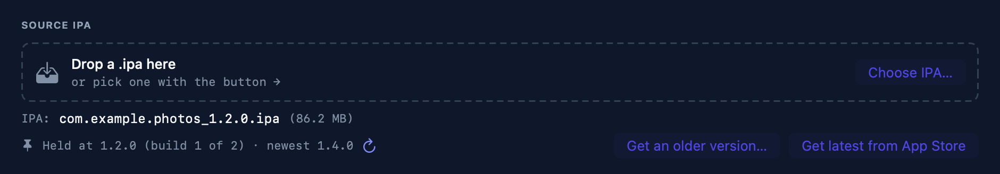

# App Store Downloads

Once you've signed in and set up decryption, Graft downloads and decrypts the
apps your Apple ID owns or can get for free.

Graft downloads the App Store's IPA with ipatool and decrypts it with
UnfairPlay, both inside Graft.app. It only downloads apps your Apple ID
already owns, or free ones it gets for that Apple ID; a paid app is bought in
the App Store, never by Graft. Everything happens on your own Mac, for your
own devices.

There are two one-time steps, both in Settings › App Store:
[Sign in](#sign-in) and [Set up decryption](#set-up-decryption).

Settings is the last item in the sidebar, under Activity: Graft has no
separate Settings window, so ⌘, opens nothing.

## Sign in

1. Press **Sign In…**.
2. Type your Apple ID (email or phone) and password.
3. Type the 6-digit code if Apple asks for one (it doesn't always).

About signing in:
- Graft types your Apple ID, password and code into the bundled ipatool's own
  prompts. They go only to
  Apple, through that ipatool. Graft never saves them, and never puts them on
  a command line, in the environment or in a log.
- ipatool, which comes with Graft, keeps your sign-in, including your
  password, in your login Keychain, as it does when you use it on its own.
- The first App Store action on a Mac (usually the first sign-in) downloads
  ipatool's App Store components (about 320 MB) and its Unicorn emulator, and
  can take several minutes. Later ones take under a minute. See
  [What Graft Downloads](downloads.md).
- If you signed in with your own ipatool, the sheet says so first: signing in
  here removes that sign-in, and your own ipatool will need to sign in again if
  you still use it in Terminal.

While you're signed in, **Sign In Again…** sits beside **Sign Out**. Use it
when Apple has ended the session: a get then says so, and names the button.
**Sign Out** signs ipatool out.

## Set up decryption

1. Install any free iPhone or iPad app from the Mac App Store (only an Apple
   silicon Mac can), signed in there with **the same Apple ID** you use in
   Graft, and open it once.
2. Press **Set Up Decryption…**. In the sheet, pick that app (the first one
   is already picked) and press **Set Up Decryption…** again. Graft then
   explains what will happen. Open the app once first (the sheet's
   **Open <app>** button does it): macOS sometimes clears the App Store state
   UnfairPlay reads, and opening the app writes it again. Then press
   **Continue**.
3. macOS's dialog usually names Graft and asks you to allow it administrator
   access ("Allow administrator access for “Graft”?"). On a Mac with Touch ID
   it offers Touch ID or **Use Password…**; on one without, it asks for your
   password. If Graft has to start this step through osascript instead, the
   dialog names osascript. **Cancel** stops here. Graft never sees the
   password.

If your macOS account isn't an administrator, macOS's dialog asks for an
administrator's name and password instead, so someone who administers this
Mac has to type them. The rest is the same: Graft never sees them, and the
decryption model it sets up is yours.

What happens:
- Before root copies anything, it checks that this Mac's App Store state
  (`SC Info.sidb`) is there. If it isn't, the step stops at once, nothing is
  changed, and Graft says which app to open.
- Graft explains the step before macOS's dialog appears, and shows the exact
  command under "The exact command, run as root".
- Root works only in a folder of its own, on its own copy of the app, and runs
  its own copy of UnfairPlay. In a Graft.app signed with a developer team, as
  releases are, root checks that copy against Graft.app's team before it runs
  it, and when Graft.app is signed with Developer ID, the copy must be too. A
  copy nothing can check is shown as a warning, and runs only if you
  press "Run Unchecked Copy as Root…".
- UnfairPlay saves a private decryption model, which Graft then moves into
  your own folder, as you.
- Cancel is always safe. The step also stops by itself if it runs far longer
  than expected (15 minutes for most apps, longer for a very large one).

Decryption then works only for apps downloaded with that Apple ID. If you
switch Apple ID, in Graft or in the Mac App Store, press **Set Up Again…**
with an app installed under the new one.

## Get an app

On the app's pane, **Get latest from App Store** downloads, decrypts and
stages the App Store's latest version. **Stop** cancels it and deletes the
download. If that version is already staged, by Get latest, a drop or a dump,
nothing is downloaded and the pane says "Already have <version>" (a copy from
Get an older version doesn't count). The button then reads **Get Again**,
which asks first, then downloads, decrypts and stages it again.

- If your Apple ID doesn't have the app yet and it's free, the button becomes
  **Get (free)**. Graft asks first, then adds the app to your Apple ID's
  purchases at no cost, as Get in the App Store would, and downloads it.
- A paid app shows **Open in App Store** instead. Buy it there, then get it
  in Graft.
- Add App's Search offers "Get it from the App Store after adding" once the
  App Store is set up.

## Get an older version

When a new version breaks a tweak, you can go back to one that worked.
**Get an older version…**, beside Get latest on the app's pane, lists the
versions the App Store still has for your Apple ID, newest first, with each
one's date. Graft reads ten at a time, and **Show More** reads the next ten.
Press **Get** on one, and Graft downloads, decrypts and stages it as Get latest
does.

.")

Graft then holds the app at that version: its builds use it, and the pane says
"Held at 1.2.0 · newest 1.4.0" instead of "update available". **Get latest
from App Store** lets go of the hold and gets the newest version again. The
hold is the app's preferred version, which Edit App also shows. A preferred
version set in Edit App is a hold too; Get latest sets it back to latest.

- Only apps your Apple ID has. If it doesn't have the app yet, get it first.
- Apple doesn't serve every old version. One it won't describe or hand over
  says so, and you can pick another.
- The App Store sometimes has more than one build with the same version
  number. Graft numbers them from the oldest, so "1.2.0 (build 1 of 2)" is the
  older and "1.2.0 (build 2 of 2)" the newer, and hovering over one says which
  it is. Show More renumbers them when it finds an older one.
- Getting one of those builds holds the app at that build: the pane says
  "Held at 1.2.0 (build 1 of 2)", and builds use that build even when the other
  is staged too. A version typed in Edit App holds by number only: changing
  the preferred version there lets go of the build, and saving Edit App with
  it unchanged keeps it. In Terminal, `graft --set-app-options --app <name>
  --preferred-version <version>` holds that version by number.
- Dropping an IPA of the held version on the app, or decrypting it from a
  jailbroken device, holds the app at that version by number, with a warning:
  Graft can't tell which build an IPA it didn't download is, so builds use the
  one you gave it.
- If the connection stalls, the list stops, and Try Again picks up where it
  stopped. A version that stalls twice in a row is marked as unavailable, and
  the list goes on.
- Some apps refuse to run once they're too old, and ask you to update.
- A version that's already staged is held without downloading it again,
  unless another build shares its number: a staged copy could be either, so
  Graft downloads the build you picked. Graft counts only the builds it has
  read: one with the same number further down, past Show More, isn't counted
  yet, and the staged copy is held by number. Show More first if you think
  there's another.
- An old version may be one UnfairPlay can't verify (see
  [Decrypts UnfairPlay can't verify](#decrypts-unfairplay-cant-verify)).

In Terminal, `graft --appstore-versions --app example` lists the versions
with their ids, and `graft --appstore-get --app example --version-id <id>`
gets one and holds the app at it; see [App Store](cli-reference.md#app-store)
in the CLI Reference.

## Privacy

The downloaded IPA carries your Apple ID and your license for the app. Graft
keeps it in a private temporary directory, deletes it afterward, and runs
UnfairPlay with `--strip-account-data`. It doesn't rely on that flag.

Every IPA Graft stages, from any source, has `iTunesMetadata.plist` (your
Apple ID and account ids) and every `SC_Info/` license directory removed, and
is checked for them before it goes into the cache.
- An IPA staged by an earlier version is cleaned the first time a build uses
  it, and so is anything a re-install or a Mac install hands over.
- If the cache can't be written (a full or read-only disk), the build warns
  and goes on from a cleaned copy instead. Only when no clean copy can be made
  does it stop, rather than ship the data.
- A sideload archive keeps the license files its signature seals, since
  removing them would break the install. Rebuild it to get rid of them.

What gets staged, built and put on a device doesn't identify you.

## Decrypts UnfairPlay can't verify

UnfairPlay checks the decrypted pages against Apple's own hashes. If it can't
(some older apps), Graft refuses the IPA and offers **Use it anyway…**, which
says what that risks, then runs the same get or drop again. If such an app
crashes at launch, the decrypt is the likely cause.
