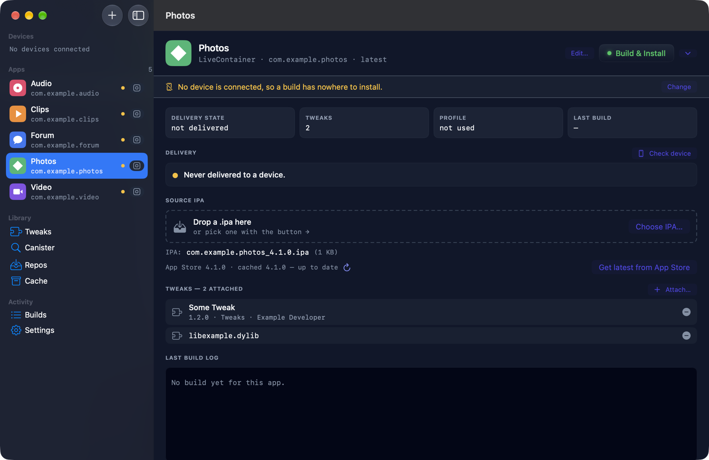

# Building & Delivery

Build & Install builds an app with its tweaks and pushes it into LiveContainer.
With a paid account, Sideload delivery installs it as a normal app instead.

Press **Build & Install**.
- **LiveContainer delivery:** Graft pushes the IPA into LiveContainer's
  Documents. Open LiveContainer on the device and import it from there. That's
  when LiveContainer signs it and the tweaks start loading.
- **Sideload delivery (paid only):** Graft signs the IPA with your
  certificate and installs it as a normal app.

Builds lists every build, with its log and archive. See [Building](#building).

## Delivery

Each app has a delivery mode, LiveContainer or Sideload. An app added without
one is LiveContainer with a free Apple ID and Sideload with a paid account.
Graft writes the mode whenever it adds an app, so an app keeps its mode if the
config later changes account. Change it in the app's Edit sheet.

### LiveContainer (recommended)

LiveContainer delivery builds the tweaked IPA unsigned and pushes it into
LiveContainer's `Documents` folder over USB or Wi-Fi. You then import it
inside LiveContainer, which runs it as a guest app.

Why this is the main path: a guest app keeps its **original bundle id**, and
some apps tie sign-in to their original bundle id. It also needs no
provisioning profile of its own, so zsign, the profile and the
device-in-profile checks are skipped for these builds.

How a delivery works:

1. Build & Install pushes `Documents/<name>.ipa` into LiveContainer.
2. On the device, open LiveContainer. The IPA is in its Documents; import it
   as an app. LiveContainer signs it on import, and that is when the tweaks
   start loading.
3. Optionally remove the pushed IPAs afterward, with Clean up in the device's
   LiveContainer section.

Delivering is not installing: Graft can see what it put in Documents, not
whether you imported it. See [Delivery state](#delivery-state).

### Sideload (paid only)

Sideload delivery signs the IPA with zsign, using your `.p12` and profile, and
installs it on the device as a normal top-level app. The device's UDID must be
in the profile. Use this for apps that don't care about their bundle id or
signing team.

On a free Apple ID, building, re-installing or adding a sideload app is
refused.

## Building

Build & Install runs this pipeline. Build options (beside it) picks the
device and can build without installing.

1. **Pre-flight.** Tools, signing files, password, device, and that the device
   is in the profile. Only what the delivery mode needs is checked.
2. **Source IPA.** The decrypted IPA staged in `~/.cache/graft/ipas/`.
3. **Decryption check.** The load commands of every Mach-O. Any that is still
   encrypted is reported as a warning naming the binary, and the build carries
   on.
4. **Inject.** cyan, with the app's tweaks and options. The original bundle id
   is kept by default. cyan's output is meant to be re-signed: its modified
   binaries carry stale signatures until then. Every delivery re-signs before
   anything runs: zsign for Sideload, LiveContainer on import, SideStore or
   PlayCover on install. A LiveContainer build that isn't installed is for one
   of those signers.
5. **Sign** (Sideload only). zsign with your `.p12` and profile.
6. **Archive.** Copy the result to `~/.cache/graft/built/`.
7. **Deliver.** Push into LiveContainer, or install on the device.
8. **Record.** Write the build to `~/.local/state/graft/log.sqlite` and apply
   archive retention.

**Stop** ends the build where it is. A stopped build shows as Stopped, not as
a failure, and adds no row to Builds.

## Build history and retention

**Builds** lists every build, with its saved log (View log…). A build's
archive can be delivered again without rebuilding (Re-install…), or shown in
Finder (Reveal in Finder).

A re-install goes out the way the archive was built: an unsigned LiveContainer
archive is never installed as a top-level app, and a zsign-signed one is never
pushed into LiveContainer. If the app's delivery mode has changed since,
rebuild it.

After each successful build, all but the newest `archive_keep` archives **per
app version** go to the Trash (default 2; `0` keeps only the build just made).
- Grouping by version means rebuilds of one version never push out the last
  build of an older version, so you can always roll back to a version you
  shipped.
- Builds you can re-install are kept first. An archive left by a build whose
  install failed only keeps a slot none of those needs.
- Archives go to the Trash, not straight to deletion, so the space comes back
  when you empty it. Staged source IPAs are never pruned.

**Clean up old builds…** in Builds does the same at your `archive_keep`: it
says how many archives would go to the Trash, and moves them when you confirm.
Useful after lowering the setting. The button is disabled while a build runs.

A clean-up never moves an archive that is still in use.
- A build holds a lock from the moment it archives its IPA until its history
  entry is written, and a re-install holds it until the archive is delivered.
- A Mac install copies a built archive under the lock and hands PlayCover the
  copy, since PlayCover reads the file after Graft has returned.
- A clean-up you start waits up to 30 seconds for them to finish, then stops
  with an error and moves nothing. A build's own clean-up doesn't wait: if
  another build is delivering, it skips this time and says so, and the next
  build catches up. Two clean-ups at once take turns.

## Delivery state

The app list and each app's pane say whether building now would produce
something different from what was last delivered.

On every delivery Graft records a SHA-256 over what determines the build: the
source IPA's bundle id and version, each tweak's filename and contents, the
cyan options and the delivery mode. Comparing that with what the config would
produce now gives one of:

| State | Means |
|---|---|
| `never` | Nothing has been delivered for this app. |
| `stale` | Something changed since the last delivery; the reasons say what (for example `some-tweak.deb rebuilt since delivery` or `app version changed: 1.2.3 → 1.3.0`). |
| `current` | Matches the last delivery. |
| `unknown` | Graft can't tell (for example a tweak file it can't read, or no staged IPA), and says so instead of guessing. |

Tweak contents are hashed, not just names, because a tweak rebuilt from source
keeps its filename. The source IPA is identified, not hashed.

Limits worth knowing:

- **Delivered is not installed.** For LiveContainer, Graft knows it wrote the
  file, not whether you imported it. Checking the device lists LiveContainer's
  Documents and can only downgrade a state: a missing file means the record is
  out of date, but a present file doesn't prove an import.
- Checking the device leaves sideload apps alone.
- A re-install of an archive that a recorded push shipped, byte for byte
  (usually the newest build), is compared like that push. Any other
  re-installed archive reads `stale`, because what went into it wasn't
  recorded.

None of this blocks a build.

## Running builds on this Mac

On an Apple silicon Mac, an app's pane has **Build for this Mac**, which makes
the build loadable under PlayCover and hands it to PlayCover. A staged IPA or
an archived build can be handed over too.

Some tweak libraries import iOS private frameworks that macOS doesn't have;
for these Mac builds Graft bundles a minimal stand-in instead. Phone builds
are never changed this way.

Graft.app carries that stand-in prebuilt, so a Mac build needs no Xcode. A
`graft` installed with pipx builds it on demand and needs full Xcode for that;
see [The CLI without the app](cli-install.md#the-cli-without-the-app-pipx).
