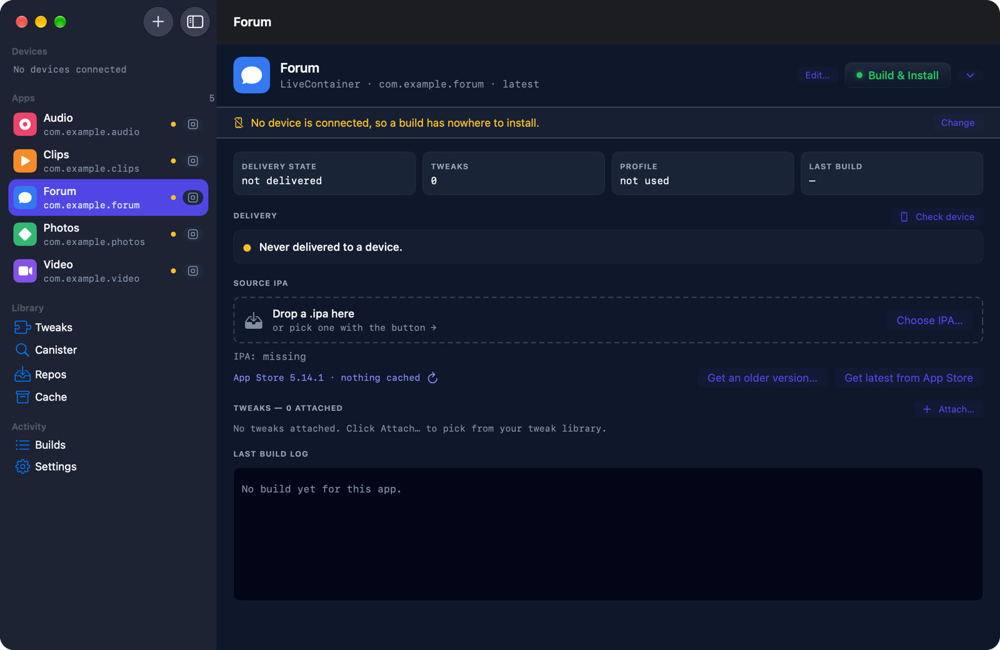

# Getting an IPA

A build needs a decrypted IPA of the app. There are three ways to get one.

- **From the App Store.** Once you've signed in and set up decryption (see
  [App Store Downloads](app-store.md)), the app's Source IPA section
  has **Get latest from App Store**. Graft downloads the app, decrypts it on
  this Mac, and stages it. If that version is already staged, it says
  "Already have <version>" and downloads nothing; **Get Again** downloads it
  anyway. **Get an older version…** beside it gets one of the app's earlier
  versions instead (see [Get an older version](app-store.md#get-an-older-version)).
- **An IPA you already have.** Drop it on the app's pane.
- **A dump from your own jailbroken device**, from the device's Decrypt card.
  See [Decrypt on a jailbroken device](#decrypt-on-a-jailbroken-device).

These are for **personal use**: your own Apple ID, apps you own or get for
free, on your own devices. Don't redistribute decrypted or modified IPAs.

## Details for each way

Each way stages the IPA in `~/.cache/graft/ipas/`, and a build uses it from
there. Graft checks every Mach-O binary in it before injecting and warns if
any is still encrypted; the build carries on, but the app will most likely not
launch. With nothing staged, the build stops and lists the ways to get one.

The App Store route has its own page,
[App Store Downloads](app-store.md).

### Bring your own

Drop the IPA on the app's pane, or choose it in Add App's Manual mode. Graft
checks that the IPA's bundle id matches the app's and stages it under its
canonical name.

An IPA that is still encrypted (straight from the App Store) is decrypted with
UnfairPlay on the way in if decryption is set up, and refused if it isn't.

### Decrypt on a jailbroken device

The device's Decrypt card dumps an installed app off your own jailbroken
iPhone or iPad, and **Add as app** turns the dump into an app. This path needs
tools Graft.app doesn't include, which you install yourself:

| Tool | Used for |
|---|---|
| [frida](https://frida.re) 16.x on the device | Both backends. The device's frida-server must be 16.x, the major frida-ios-dump's virtualenv installs. Graft has no frida of its own: it asks frida-ios-dump's (`graft_ipa/frida_probe.py`), so until frida-ios-dump is set up, the decrypt check can't reach frida-server and says so. |
| [frida-ios-dump](https://github.com/AloneMonkey/frida-ios-dump) | One backend. Clone it to `~/.local/share/graft/frida-ios-dump`, check out `56e99b2` (its last release for frida 16; the current one needs frida 17), and create a `.venv` there with `pip install 'frida==16.*' paramiko scp tqdm`, or set `GRAFT_FRIDA_IOS_DUMP`. The decrypt check prints these commands when it isn't set up. Needs OpenSSH on the device. |
| [bagbak](https://github.com/ChiChou/bagbak) | The other backend. `npm install -g bagbak@4.0.3` for a 16.x frida-server. |
| `iproxy`, from libimobiledevice | The SSH tunnel to the device. `brew install libimobiledevice`, or from MacPorts, `sudo port install libimobiledevice`. |

The card checks what, if anything, is blocking a dump right now. Unless you
choose a backend, Graft picks the one that can run, preferring frida-ios-dump:

- **frida-ios-dump** attaches to the running app. Graft brings it to the
  foreground first, launching it if needed. It copies the bundle over SSH:
  store the device's root password with **Set root password…**, or set
  `GRAFT_SSH_KEY` (and `GRAFT_SSH_USER` if it isn't `root`).
- **bagbak** spawns the app itself. bagbak 4.x (the version that works with a
  16.x frida-server) also copies the bundle over SSH, using the same stored
  root password; it can't use `GRAFT_SSH_KEY`.

A dump is always of the whole app, which is what gets verified and staged. A
dump that leaves app extensions encrypted (an extension built for a newer iOS
than the device runs) drops them and stages the rest, and says what it
removed. The app keeps working, minus those widgets and share extensions.

### Staged IPAs

**Cache** lists every staged IPA, and marks the one a build uses when a bundle
id has more than one. From there you can add a dump as an app, install it on
this Mac with PlayCover, or delete it. Staged IPAs are never pruned.
