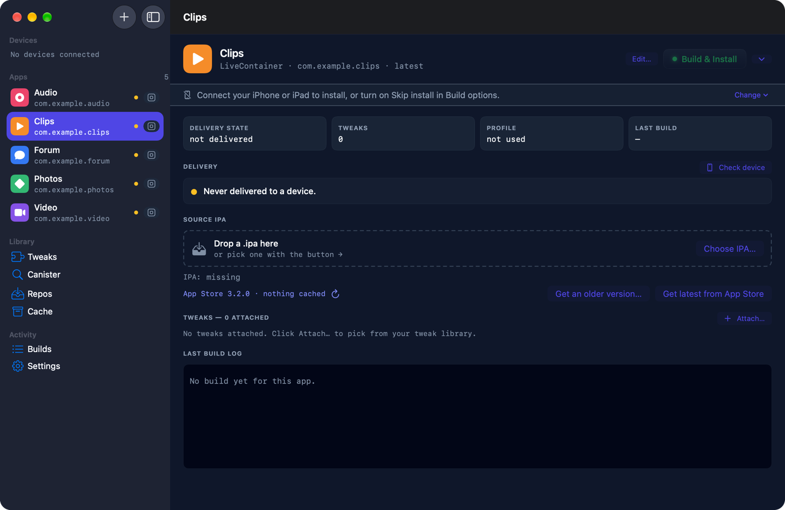

# Getting Started

Install Graft and check what it needs. Each of the five steps to installing an
app has its own page.

## Install

1. Download `Graft.zip` from [GitHub Releases](https://github.com/GreenglassT/Graft/releases).
2. Unzip it, move `Graft.app` to `/Applications`, and open it.

Graft.app carries everything it needs:
- the `graft` CLI, with its own Python;
- cyan, zsign, ldid, ipatool, UnfairPlay and the other helpers.

You don't need Homebrew, pipx, Python, Go, Xcode or libimobiledevice. The
one exception is decrypting on a jailbroken device, which still needs
libimobiledevice's `iproxy` and tools you install yourself (see
[Decrypt on a jailbroken device](getting-an-ipa.md#decrypt-on-a-jailbroken-device)).

## Requirements

- **A Mac with Apple silicon and macOS 14 or later.** On an Intel Mac,
  Graft.app opens to a screen that says it needs Apple silicon.
- **An iPhone or iPad** paired with this Mac, connected by USB, or on the
  same network with Wi-Fi sync turned on.
- **An Apple account,** of one of two kinds. The first run asks which you
  have, and Settings switches later.
  - A **free Apple ID**, with LiveContainer on the device. Graft builds
    unsigned IPAs and pushes them into LiveContainer, which signs them when
    you import them. Graft never signs anything itself on this account.
  - A **paid Apple Developer Program membership**, with a development
    certificate exported as a `.p12` and a provisioning profile (a wildcard
    profile is simplest) that includes your device.

### What each feature needs

| To | You need |
|---|---|
| Build and push into LiveContainer | LiveContainer on the device. With a free Apple ID, install it with SideStore, AltStore, iloader or Impactor, which also refresh it every 7 days. |
| Install an app as a normal app (Sideload) | A paid membership, its `.p12` and a profile that includes the device. |
| Install or update LiveContainer from Graft | A paid membership and an App Store Connect API key. |
| Make each app's provisioning profile automatically | A paid membership and an App Store Connect API key. |
| Search the App Store | Nothing. No Apple ID is involved. |
| Download from the App Store | An Apple ID signed in in Graft. Any Apple ID works, free or paid; it's separate from the account above. The app must be one that Apple ID owns, or a free one Graft can get for it. |
| Decrypt App Store downloads | An iPhone or iPad app installed on this Mac from the Mac App Store, with the same Apple ID, and opened once. Any free one will do. |
| Decrypt on a jailbroken device | A jailbroken iPhone or iPad with frida-server 16.x and OpenSSH, plus tools you install yourself (see [Decrypt on a jailbroken device](getting-an-ipa.md#decrypt-on-a-jailbroken-device)). |
| Run a build on this Mac | [PlayCover](https://github.com/PlayCover/PlayCover/releases), a free app you install yourself. Graft doesn't include it. |

## The five steps

Each step has its own page:

1. [Set up your Apple account](apple-account.md)
2. [Add an app](adding-apps.md)
3. [Give it a decrypted IPA](getting-an-ipa.md)
4. [Attach tweaks](tweaks.md)
5. [Build and install](building-and-delivery.md)
