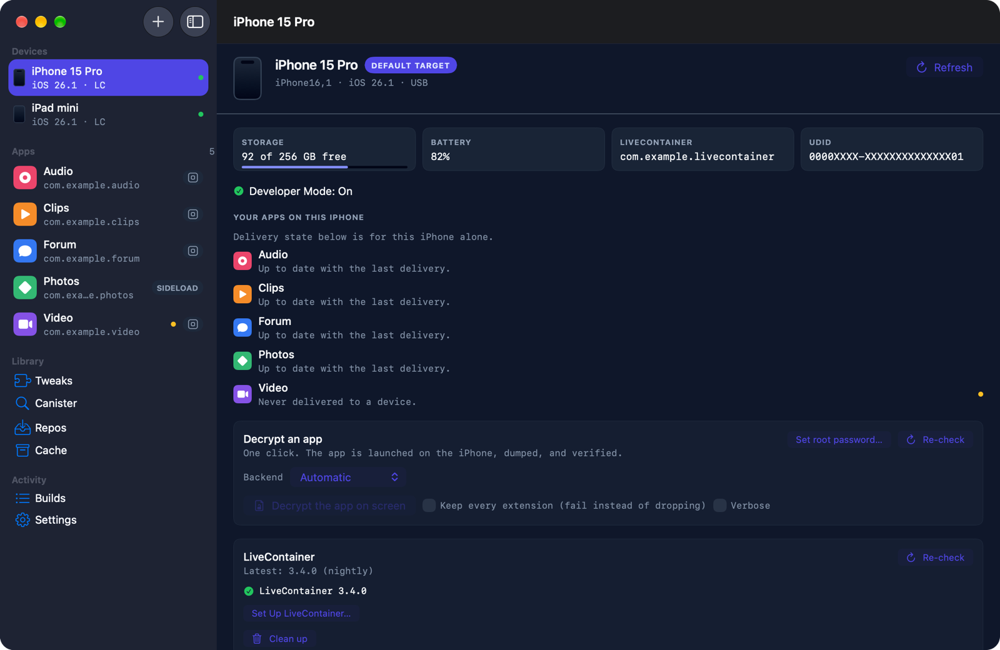
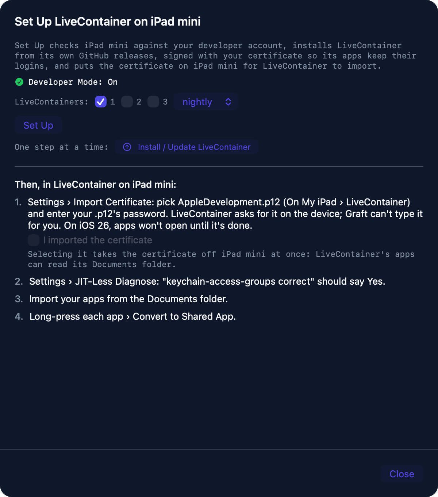

# LiveContainer

Graft pushes builds into the LiveContainer already on your device, and with a
paid account it can install and update one itself.

If LiveContainer is already on the device through SideStore, AltStore,
iloader or Impactor, Graft uses it as it is. With a paid account Graft can
also install and update LiveContainer itself, signed with your certificate so
that guest apps keep their logins.

## The device's LiveContainer section

A device's pane has a LiveContainer section. It lists what is installed and
who manages it, on either account.

- **Set Up LiveContainer…** does the whole setup in one sheet. With a paid
  account, its **Set Up** button checks the device against your developer
  account (reading the registered devices again if the device is new to
  them), installs LiveContainer from its own GitHub releases, and puts the
  certificate on the device. It stops at a step that fails and says what's
  left. After a failed certificate step, Set Up again puts the certificate on
  without installing again. **Install / Update LiveContainer** and **Put
  certificate on device** are in the sheet too, one step at a time. While a
  step runs, the sheet stays open until it ends or you press **Stop**.
- The sheet then lists the steps on the device, naming it: Import Certificate
  in LiveContainer's Settings, JIT-Less Diagnose, import your apps, and
  Convert to Shared App. LiveContainer asks for your .p12's password on the
  device; Graft can't type it for you. Selecting **I imported the
  certificate** takes the certificate off the device at once.
- Set Up and **Install / Update LiveContainer** need an App Store Connect key.
  Without one, the sheet says so, with **Open Settings**. They install one
  LiveContainer, the primary, unless more are on the device already; select
  2 and 3 for side-by-side copies. The sheet also shows whether Developer Mode
  is on, which a LiveContainer from Graft needs on iOS 16 and later, with
  **Check again** for after the device restarts.
- With a free Apple ID, the sheet has no Set Up button. When LiveContainer is
  already on the device, it says which version it found, and the one step left
  is Import Certificate from SideStore. Otherwise it links to SideStore and
  iloader, which install LiveContainer with your Apple ID. Then it lists the
  same steps on the device.
- Where SideStore or AltStore is on the device, Set Up is disabled, and the
  sheet's first step is Import Certificate from SideStore.
- While a certificate Graft put on the device is still there, the section
  says so, with **Remove it**.
- **Clean up** is there whenever the device has a LiveContainer, whoever
  installed it.

## Side-by-side LiveContainers

Up to three LiveContainers can be installed side by side, as
`com.kdt.livecontainer.<TEAM>` (the primary), `com.kdt.LiveContainer2.<TEAM>`
and `com.kdt.LiveContainer3.<TEAM>`.

Every installer names them this way, with its team id, so Graft finds them on
the device by bundle id: a ten-character team id after the name, whatever team
it is, in any letter case. A free Apple ID needs no team id in the config.

System apps count too, so a LiveContainer that TrollStore or a jailbreak
installed (often as plain `com.kdt.livecontainer`) is found, and so is one an
on-device re-signer gave some other suffix.

## Which one a build pushes into

In this order:

1. the app's pin (the LiveContainer picker in its Edit sheet, or
   `lc_bundle_id:` in config.yaml), in any letter case, or the id without its
   team suffix when that names exactly one. A pin that names nothing
   installed, or an app that isn't LiveContainer, stops the build with what
   was found; it's never quietly ignored;
2. the only LiveContainer on the device, whatever its bundle id;
3. with a paid account, the configured team's primary;
4. the only primary (`com.kdt.livecontainer.<TEAM>`, or plain
   `com.kdt.livecontainer`).

Anything else stops the build with a list of what was found. That includes
plain `com.kdt.livecontainer` next to a `com.kdt.livecontainer.<TEAM>`: Graft
can't tell which one you import from, so it asks you to pin one rather than
guess.

A build finds out before it injects anything: the push's target, and whether
its `<app>.ipa` name is free there, are checked ahead of cyan. The sidebar
names the LiveContainer a push would use, found the same way.

## Installing LiveContainer from Graft

Installing LiveContainer needs an App Store Connect API key (Settings › App
Store Connect) to fetch profiles. It also needs the App IDs above (plus the
primary's extensions) registered at developer.apple.com with the App Groups
capability and the group `group.com.SideStore.SideStore.<TEAM>` assigned.
App groups can't be assigned through the API; if one is missing, the error
names the App ID.

On a device where AltStore or SideStore manages LiveContainer, Graft won't
install over it, because replacing those copies would break every guest app
signed through them. Update through AltStore or SideStore instead.

## Put certificate on device

**Put certificate on device** is for a LiveContainer Graft installed: it has
no AltStore to take a certificate from, and its JIT-less mode needs one.
Import it in LiveContainer's Settings, then select **I imported the
certificate** in the sheet, or press **Remove it** on the device's pane.
Until then the certificate sits where guest apps can read it.

## Files in LiveContainer's Documents

Graft never deletes or replaces a file in LiveContainer's Documents unless
it knows the file is its own: a delivery record for that device and that
LiveContainer, or, with no record (after a state reset, say), the file's
SHA-256 matching one of that app's archived builds.
- Clean up removes only the IPAs Graft's deliveries recorded and a
  certificate it recorded pushing, and retires those records, so a file you
  later put there under the same name is yours.
- An `AppleDevelopment.p12` with no record (one you put there yourself) is
  reported and left in place. Putting the certificate on the device replaces it
  only when its bytes are your configured `.p12`.
- A build whose IPA name (`<app>.ipa`) is already taken by a file that isn't
  Graft's stops instead of overwriting it. Rename or remove that file in the
  Files app, then build again. A re-push of Graft's own earlier delivery
  replaces it as before.
