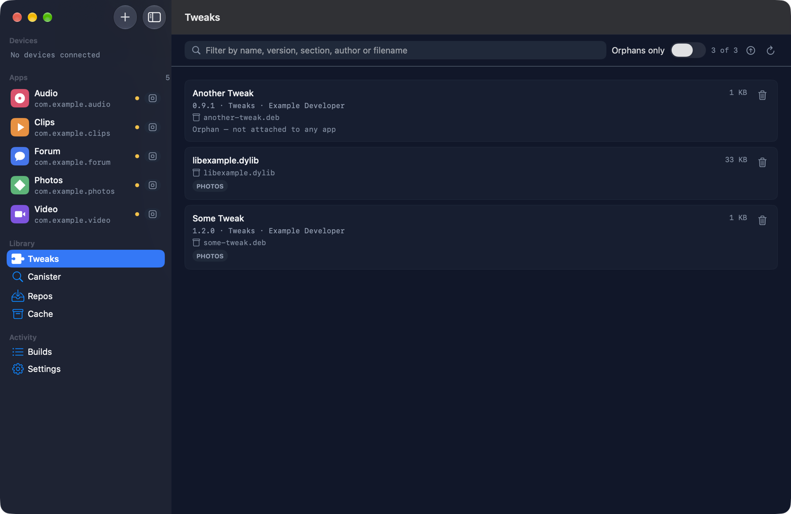

# Tweaks

Tweaks from Canister or an APT repository go into your tweaks library, and from
there you attach them to an app.

1. Find tweaks under **Canister** or in your **Repos**.
2. Download them into **Tweaks**.
3. Press **Attach…** on the app's pane.

A `.deb` or `.dylib` you already have goes into the tweaks folder too.

## Canister, Repos and Tweaks

- **Canister** searches canister.me. A download by package id is checked
  against Canister's published SHA-256, when Canister has one.
- **Repos** adds APT repositories and lists their packages. Free repositories
  only; repos that need a login or payment aren't supported.
- **Tweaks** lists your library (`~/.config/graft/tweaks/`), checks it for
  newer published versions when you ask, and updates a tweak, re-pointing the
  apps that use it. Deleting one an app still uses asks first, and offers
  Detach and Delete. Deleted tweaks go to the Trash.

Updating an app (**Update & Install** on its pane, or `graft --update`) also
updates every tweak it uses that has a newer build, once for all the apps that
share it. While an update of an app runs, the **Update** button in Tweaks for
the tweaks that app uses waits until it's done. See
[Updating your apps](building-and-delivery.md#updating-your-apps).

## Shared libraries

cyan bundles ElleKit as CydiaSubstrate and adds a few common frameworks when a
tweak links them, but not every shared library a tweak may link against
(color or settings libraries, for example).

If a build fails with `Library not loaded: @rpath/libexample.dylib`, put a
sandbox-compatible copy of that library in the tweaks folder and attach it to
the app, as you would a `.deb`.

## Rootless tweaks only

Tweaks built for RootHide depend on `libroothide.dylib`, which doesn't exist
outside a jailbreak. Use the rootless build from the developer's own
repository or releases.
